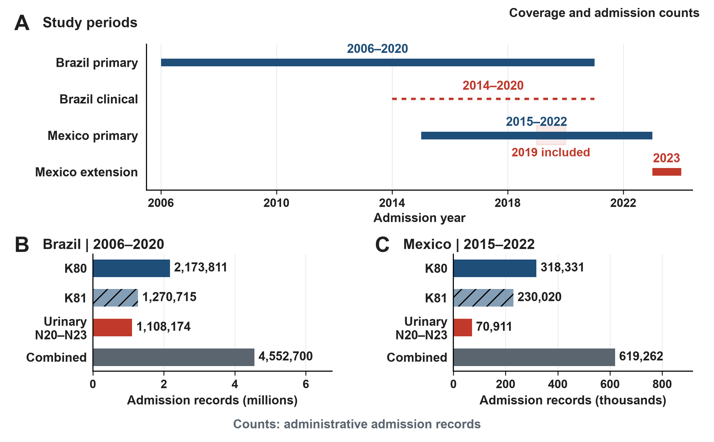
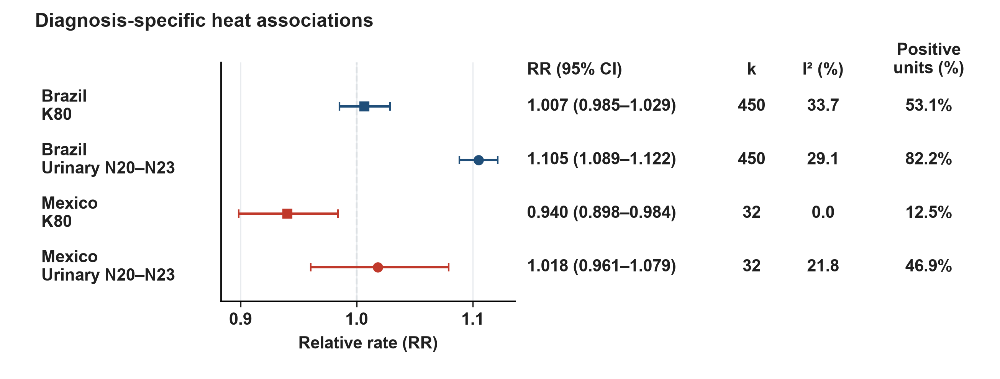
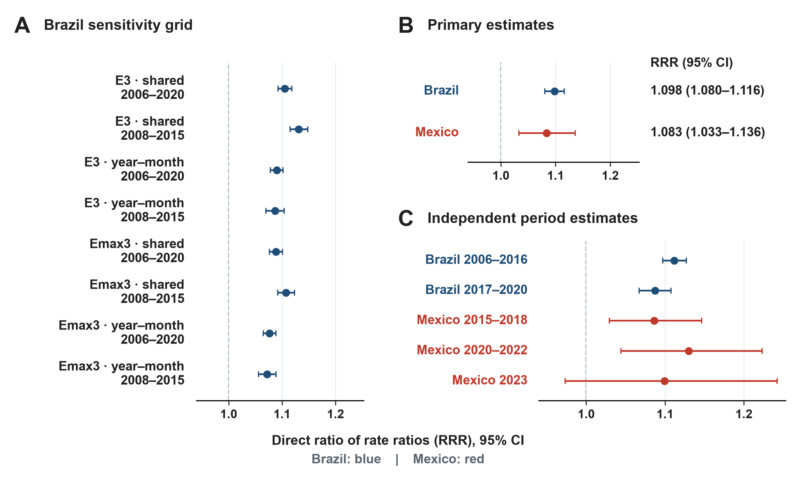
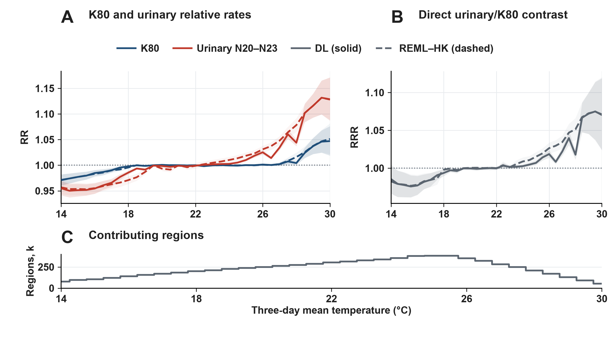

# Short-Term Heat and Hospital Admissions in Brazil and Mexico: A Direct Comparison of Urinary Calculi and Renal Colic With Gallbladder and Bile Duct Stones

Shuo Feng¹, Chao Shi¹, Tianming Liu¹, Haoran Ding¹, Fenghe Hang¹, Zhenghao Huang¹, Xianzhi Meng¹*

¹ Provincial Key Laboratory of Hepatosplenic Surgery, The First Affiliated Hospital of Harbin Medical University, Harbin, China

* Corresponding author: Xianzhi Meng; Email: [mengxianzhi@hrbmu.edu.cn](mailto:mengxianzhi@hrbmu.edu.cn)

## Abstract

Do short-term heat associations differ between admissions for urinary calculi or unspecified renal colic and admissions for gallbladder or bile duct stones, and can the contrast be observed in Brazil and Mexico? We analyzed administrative admission records from 450 Brazilian health regions (2006–2020) and 32 Mexican states (2015–2022). Joint quasi-Poisson models compared each unit’s 95th percentile of three-day mean temperature with its median, using the same local temperatures for both diagnoses. The directly estimated ratio of rate ratios (RRR), comparing the two diagnoses’ temperature associations, was 1.098 (95% CI 1.080–1.116) in Brazil and 1.083 (1.033–1.136) in Mexico. The contrast had the same direction in both countries, but the diagnosis-specific patterns differed. Brazil had more urinary admission records at higher temperatures, with the gallbladder-or-bile-duct-stone estimate near the null. Mexico had fewer gallbladder-or-bile-duct-stone records at higher temperatures, while the urinary estimate was near the null and its interval included one. In the Brazilian clinical subcohort, the strict N20-versus-K80 contrast was larger for urgent versus elective admissions; the formal interaction estimate was 1.156 (1.086–1.232). Thus, a similar relative contrast can accompany different diagnosis-specific admission patterns. Studies should report both the direct comparison and each diagnosis’s association, recognizing that administrative records cannot distinguish disease onset from care-seeking and admission decisions.

## Introduction

Our outcomes are admissions for urinary calculi or unspecified renal colic (ICD-10 N20–N23) and admissions for gallbladder or bile duct stones (ICD-10 K80), the latter treated as one combined diagnosis group. Short-term ambient temperature has been associated with clinical kidney-stone presentations in US cities and with renal-colic emergency care in Ontario [1,2]. Population-based work in South Carolina and time-series studies in Seoul have examined urinary-stone emergency presentations [3,4]. Studies in Guangzhou and Cuneo considered renal colic and urinary calculi, with differences in diagnosis and clinical setting [5,6]. An Adelaide study examined urolithiasis within a broader renal-disease group [7]. Brazilian studies have related admissions to monthly climate variation and, more recently, to state-month heat metrics [8,9]. The biliary evidence uses different outcomes: acute cholecystitis admissions in Japan and urgent K80–K81 admissions within a Madrid hepatobiliary study [10,11]. Malig and colleagues already examined urinary stones and a broader biliary-tract category in the same study of warm-season unscheduled hospitalizations in California [12]. Under the same local temperature contrast, do the two groups have different short-term heat associations, and is the direction of that difference observed in two health systems?

Estimating each diagnosis separately and comparing whether its association reaches statistical significance does not test whether the associations differ [13,14]. A direct interaction contrast addresses that comparison [15]. We use a joint model in which both diagnosis groups share their geographic unit’s reference temperature, and report the relative difference alongside each diagnosis’s association. The common reference is local to each region or state; it is not one absolute temperature shared by both countries. Both components are needed to interpret the comparison. A relative contrast above one could reflect more urinary admissions at higher temperatures, fewer gallstone admissions, or both. Those possibilities have different clinical meanings even when the relative contrast points in the same direction.

Our primary aim was to directly compare the short-term heat associations of the two diagnosis groups using administrative hospital admission records from Brazil and Mexico, and to assess whether the diagnosis contrast had the same direction in both countries. We then examined whether that agreement was accompanied by similar diagnosis-specific admission patterns. A secondary analysis compared urgent and elective admissions in the Brazilian clinical subcohort.

## Materials and Methods

### Study design, data sources and outcomes

We conducted a time-series study of SIH-SUS hospital admission records from Brazil and DGIS/SAEH records from Mexico [16,17]. Brazil covered 450 health regions during 2006–2020; Mexico covered 32 states during 2015–2022, including 2019 (Figure 1A; Table 1). Records were assigned to residence geography and admission date: residential municipality and DT_INTER in Brazil, and habitual-residence state ENTIDAD and INGRE in Mexico. The counting unit was an administrative admission record within the included systems. The Brazilian data cover publicly financed SIH-SUS care, and the Mexican data cover the facilities in the selected SAEH files.

Principal diagnosis defined the primary comparison: N20–N23 for urinary calculi or unspecified renal colic, and K80 for gallbladder or bile duct stones [18]. K80 was analyzed as one combined group. K81 identifies acute, chronic or unspecified cholecystitis and does not establish calculous disease; it was included as a third outcome in the primary joint model, but was neither the numerator nor denominator of the primary comparison. K85 was excluded because of discontinuities in recorded counts. Detailed code definitions and the evidence for this exclusion are given in Supplementary Methods.

For Mexico, we selected one file per source year and retained records by admission date, including admissions appearing in later source files. The annual files are primarily discharge-based, so source year and admission year were kept distinct. Invalid admission dates or residence codes were excluded. We examined source-year/discharge-year concordance and exact and non-ID candidate record matches, with conservative candidate-repeat exclusion as a sensitivity. The 2023 extension additionally used the 2024 discharge source for next-year follow-up. Brazilian clinical analyses held admission dates at 2014–2020 and compared processing-source years 2014–2021 with 2014–2020. Source selection, reconstruction and exclusions are documented in Table S1. Missing health observations remained missing; observed zero-admission days remained zero.

### Temperature exposure and the shared local comparison

Daily temperature came from ECMWF reanalysis fields [19,20]. Brazil used population-weighted ERA5-Land temperatures. Mexico used cosine-latitude area weights over valid land-grid cells contained within its state polygons; the extension retained the archived grid and aggregation. Hourly observations were averaged over the UTC day. Historical Mexican file headers were consistent with ERA5-Land, although the original retrieval requests were unavailable. Spatial weights were normalized over usable observations:

`X = Σ(w × x × valid) / Σ(w × valid)`.

Here, x is grid-cell temperature, w is the relevant spatial weight, and valid identifies usable observations. This denominator preserves the temperature scale when cells are unavailable. The primary exposure E3 was the mean of temperature on the admission date and the preceding two actual calendar days. Exposure histories were constructed before outcome and period exclusions; incomplete windows were excluded.

Each unit’s P95 and median were calculated from its full primary-eligible E3 distribution and shared across diagnoses. These targets were not recalculated by year or season. The temperature response used a three-column natural spline, with internal knots at the unit’s one-third and two-thirds E3 quantiles and boundary knots at its observed minimum and maximum; prediction reused the fitted basis [21]. Unit-specific target distributions are summarized in Table S2 using empirical type-7 quantiles [22]. Clinical and admission-origin analyses defined their shared targets and basis from their own eligible analysis calendars.

### Joint models, direct diagnosis contrasts and uncertainty

Within each unit, K80, K81 and N20–N23 daily counts were stacked in a quasi-Poisson log-link model. Time-series adjustment addressed weekday, month and longer-term variation [23]:

`log μ_ort = α_or + B(E_rt)'β_or + weekday_or(t) + month_or(t) + ns(time,12)_or + offset_rt`.

Diagnosis interactions allowed exposure, weekday, month and the 12-df time trend to differ across all three outcomes. Brazil included log regional population as an offset. Mexico had no population offset and estimated relative changes in within-state admission counts. Eligibility required at least 250 common dates with complete exposure and all three outcomes, and at least 40 events for each outcome. Thus, K81 affected eligibility even though Table 2 reports only K80, urinary diagnoses and their direct comparison. Nonconvergent or numerically invalid fits were excluded under the same criteria.

The unit-specific log ratio of rate ratios was

`δ_r = [B(P95_r) − B(M_r)]' (β_urinary,r − β_K80,r)`.

Exponentiating δ_r gives the RRR: the urinary group’s P95-versus-median rate ratio relative to the corresponding K80 rate ratio within the joint model. Its variance used the full joint coefficient covariance, including cross-diagnosis covariance. We also extracted each diagnosis’s RR from these same fits. Separately pooled diagnosis-specific RRs have their own weights and cannot be divided to reconstruct the directly pooled RRR.

Daily scores were summed across diagnoses and aligned on actual dates. Unit covariance used Bartlett heteroskedasticity-and-autocorrelation-consistent estimation with 14 daily lags (HAC14), without a second quasi-Poisson dispersion multiplier [24,25]. A unit-day cluster accounts for correlation among diagnosis rows on that day; the lag terms additionally account for correlation across days. Unit log contrasts were pooled separately by country using DerSimonian–Laird (DL) random effects [26]. REML with Hartung–Knapp inference was an alternative [27,28]. We report geographic-unit count k, I² and the proportion of unit log contrasts above zero [29]. The last measure describes direction, not statistical significance.

Principal country intervals retained the DL point estimate and observed weights. We summed normalized, DL-weighted unit influences on the same calendar and applied Bartlett HAC14, then added the modeled between-unit component, τ² multiplied by the sum of squared normalized weights. These intervals condition on the observed weights and heterogeneity. Table S3 gives the covariance alternatives; Table S4 gives aligned marginal and direct contrasts under independent-unit and synchronized intervals. Paired-day HC0, model-based covariance, HAC28/HAC90 and synchronized conditional-only intervals were sensitivity analyses.

### Clinical secondary analyses

Strict-code comparisons assessed whether the broad urinary definition accounted for the main pattern. We examined N20, N20–N21 and N23 separately, together with calculus-associated biliary definitions. K80.3 was classified as cholangitis without a blanket acute label. In Brazil, urgent and elective admissions were CAR_INT 02 and 01; other or unknown values were kept separate. A four-outcome joint model for N20 and K80 within these two categories estimated the exposure-by-diagnosis-by-admission-type interaction. It required at least 400 eligible exposure days, at least two distinct E3 values and positive counts in every outcome category. Stratum RRRs and the formal interaction used the same successful joint-fit regions and full covariance, with their respective pooling weights. In Mexico, PROCED 2 denoted emergency-department origin and PROCED 1 outpatient-consultation origin. Verified dictionaries supported 2016–2022; 2015 was excluded from this comparison. These origin categories differ from Brazilian admission urgency (Table S5). Strict-code and admission-category definitions are detailed in Table S6.

Adult case-composition analyses compared broad N20–N23 with K80 in six age–sex strata: ages 18–44, 45–64 and 65 or older, separately by sex. Each unit required at least 400 days and 30 cases in each age–sex–diagnosis cell. Both diagnoses received the same fixed country-level weights from pooled adult cases:

`RRR_std = [Σ_s w_s RR_urinary,s] / [Σ_s w_s RR_K80,s]`.

This is a ratio of arithmetic weighted stratum-specific RRs. Delta-method variance used the full date-aligned covariance of the twelve log contrasts, treating the observed case weights as fixed. Brazilian matched-source adult weights were reused for the later-processing-source cohort; preferred-cohort weights and uniform weights were sensitivities. Standardized and unstandardized estimates were compared on the same successful units, dates and temperature targets (Table S7). This analysis describes adult case composition and is separate from the strict-code urgency interaction. Fit coverage for the clinical and other targeted comparisons is reported in Table S8.

### Sensitivity and exploratory analyses

The Brazilian eight-cell grid crossed E3 versus the three-day mean of daily maximum temperature, two calendar models, and 2006–2020 versus 2008–2015 (Table 3). One calendar model shared weekday, month and 12-df time-trend coefficients across diagnoses while retaining diagnosis-specific exposure responses. The other used diagnosis-specific weekday and year–month fixed effects in a quasi-Poisson GLM. The grid’s full-period label refers to 2006–2020; its shared-calendar model differs from the primary diagnosis-specific calendar model. Rolling windows covered lags 0–2, 0–6, 0–13 and 0–20 days. Core specifications are collected in Table S9; Mexico’s comparator cohort excluding 2019 and its pandemic-year and leave-one-state-out checks are in Table S10.

A flexible-calendar model replaced month categories and the full-period trend with a continuous natural time spline using six degrees of freedom per analysis year, weekday and national holidays, all diagnosis-specific. It retained the primary temperature targets and basis. The Brazilian urgency analysis excluding 2020 separately retained the original diagnosis-specific weekday, month and 12-df trend, with full clinical-period targets and basis. Common-success comparisons separated a change in specification from a change in fitted units (Table S11). We examined temperature together with moisture, as in previous urinary-stone research [30]. Matched-sample models added diagnosis-specific three-df splines for three-day dew point or relative humidity while retaining temperature targets, basis and calendar terms (Table S12). Humidity was derived after spatial aggregation, so it differs from an average of grid-cell humidity.

The distributed-lag nonlinear model used raw daily mean temperature across lags 0–21 [31]. A three-df temperature spline was crossed with a three-df lag spline, with an internal lag knot at √21 and boundaries at 0 and 21. At least 400 complete-history paired dates and 40 events per endpoint were required; cumulative covariance used calendar-aligned HAC28. Its sustained daily-temperature history used the numerical main-analysis E3 P95 and median values, a different exposure history from the primary rolling-mean contrast (Table S13). Full basis and prediction details are in Supplementary Methods.

Independent period models were refitted for Brazil in 2006–2016 and 2017–2020, and Mexico in 2015–2018, 2020–2022 and 2023. Fixed-target refits retained full-period numerical temperatures and the fitted basis; period-reference alternatives changed the targets while retaining the basis. Locally supported and common-unit results are provided in Table S14. Exploratory diagnosis-specific analyses compared P95 with a fitted minimum-risk temperature (MRT) constrained to P10–P60, using at least 400 days and 100 events. Their intervals condition on the selected minimum. Unit coefficient simulations reselected MRT in 1,000 draws on a fixed 2,001-point grid (Table S15; Figure S1). This different reference does not replace the shared-median primary comparison.

### Exposure–response curves and absolute-count scenario

For each temperature, a Brazilian region contributed to a curve only within its E3 P2–P98 and with at least 30 eligible days within ±1 °C. DL and profiled REML–Hartung–Knapp estimates used identical contributor sets and pointwise 95% intervals. Contributors, weights and heterogeneity can change across temperatures; the plotted line therefore combines local contrasts from changing geographic sets. Supported and all-successful-unit estimates are in Table S16; curve support and weighting diagnostics are in Table S17. The main display ends at 30 °C.

The Brazilian absolute-count scenario compared model-predicted daily records when each region’s E3 was set to its own P95 versus median, averaging over observed calendar and population covariates. We summed the regional changes for each diagnosis and directly estimated the difference between the urinary and K80 changes. Uncertainty used the full prediction-difference gradient and synchronized daily influences with HAC14. This scenario places the relative associations on a daily admission-record scale.

## Results

### Study coverage and direct diagnosis comparison

The primary analysis covered 450 Brazilian health regions and 32 Mexican states, with 2,464,415 and 93,440 exposure-eligible unit-days, respectively. The full health calendars contained 2,173,811 K80 and 1,108,174 urinary admission records in Brazil, and 318,331 and 70,911 in Mexico (Figure 1B,C; Table 1). The median unit-specific P95-minus-median increment was 3.51 °C (IQR 2.84–3.96) in Brazil and 3.68 °C (2.96–4.51) in Mexico (Table S2).

## Table 1

Coverage, diagnostic counts and exposure descriptors for the two primary cohorts. Calendar and exposure-eligible unit-days are distinct; missing health unit-days and zero-admission eligible days are shown separately. Admission totals are full-health-calendar records, not unique people; they include all calendar unit-days rather than only exposure-eligible days. E3 percentiles describe pooled eligible unit-days. The target increment summarizes the already-defined unit-specific P95-minus-median contrasts; its across-unit median and quartiles use empirical type-7 quantiles. 

| Characteristic | Brazil, primary 2006–2020 | Mexico, preferred 2015–2022 |
| --- | --- | --- |
| Geographic units | 450 | 32 |
| Calendar unit-days | 2,465,550 | 93,504 |
| Calendar dates | 5,479 | 2,922 |
| Exposure-eligible unit-days | 2,464,415 | 93,440 |
| Missing-health unit-days | 1,135 | 0 |
| Zero-admission unit-days (health calendar) | 990,206 | 7,300 |
| Zero-admission eligible unit-days | 990,206 | 7,289 |
| Mean E3 temperature (°C) | 23.34 | 20.60 |
| Median E3 temperature (°C) | 24.04 | 20.83 |
| P05 E3 temperature (°C) | 16.17 | 12.34 |
| P95 E3 temperature (°C) | 28.49 | 28.26 |
| Unit-specific P95-minus-median increment, median (IQR; °C) | 3.51 (2.84–3.96) | 3.68 (2.96–4.51) |
| K80 admission records | 2,173,811 | 318,331 |
| K81 admission records | 1,270,715 | 230,020 |
| Urinary N20–N23 admission records | 1,108,174 | 70,911 |

### Figure 1

Coverage and diagnostic admission records. A, Primary admission periods in Brazil (2006–2020; k=450) and Mexico (2015–2022; k=32), the Brazilian clinical period (2014–2020), and the independent Mexican 2023 extension. Mexico’s primary cohort includes 2019; its comparator cohort excludes that year. B,C, K80, K81, N20–N23 and their combined admission counts, shown on separate country count scales. K80 combines gallbladder and bile duct stones; K81 identifies cholecystitis; N20–N23 includes urinary calculi and unspecified renal colic. Mexico’s full calendar contains 93,504 state-days, including 7,300 zero-admission days; 93,440 state-days have complete exposure windows. Counts are administrative admission records; k denotes included regions or states.

For the same local P95-versus-median temperature contrast, the directly estimated urinary-versus-K80 RRR was 1.098 (95% CI 1.080–1.116) in Brazil and 1.083 (1.033–1.136) in Mexico (Table 2). The corresponding unit-level I² values were 21.1% and 30.3%, with positive contrasts in 76.4% and 62.5% of units.

The diagnosis-specific estimates explain why the relative contrast had the same direction but a different pattern in each country. In Brazil, higher temperature was associated with more admissions for urinary calculi or unspecified renal colic: RR 1.105 (1.089–1.122), compared with 1.007 (0.985–1.029) for admissions for gallbladder or bile duct stones. In Mexico, the K80 RR was 0.940 (0.898–0.984), while the urinary RR was 1.018 (0.961–1.079) (Figure 2). Thus, the Mexican urinary interval included one, whereas its K80 estimate was below one.

### Figure 2

Diagnosis-specific associations for the shared local temperature contrast. Points show country-pooled rate ratios (RRs), comparing each unit’s 95th percentile (P95) of three-day mean temperature (E3) with its median. The same geographic units contribute to both diagnoses within each country (Brazil k=450; Mexico k=32). Squares identify K80 (gallbladder or bile duct stones) and circles urinary N20–N23 (urinary calculi or unspecified renal colic); colors identify Brazil (blue) and Mexico (red). Bars are synchronized 95% confidence intervals using heteroskedasticity-and-autocorrelation-consistent covariance with 14 daily lags (HAC14) and the modeled between-unit component from DerSimonian–Laird (DL) pooling. The number of geographic units is k; I² describes between-unit heterogeneity. I² and positive-unit proportions, respectively, are 33.7% and 53.1% for Brazilian K80; 29.1% and 82.2% for Brazilian urinary diagnoses; 0.0% and 12.5% for Mexican K80; and 21.8% and 46.9% for Mexican urinary diagnoses. These summaries use unit-HAC14 estimates; positive units have RR>1. Table 2 gives the estimates and directly pooled ratios of rate ratios (RRRs); separately pooled marginal RRs do not reconstruct the direct RRR.

## Table 2

Aligned country-specific marginal RRs and directly estimated urinary-versus-K80 RRRs for the same primary joint-fit unit sets, using each unit’s P95 versus its shared median. Marginal RRs retain endpoint-specific pooling weights; dividing them does not recover the directly pooled RRR. Intervals are the reported calendar-synchronized Bartlett HAC14 inference with the modeled DL between-unit component, conditional on observed weights and heterogeneity. k, I² and positive-unit direction are reported unit-level summaries. 

| Country / endpoint | RR or direct RRR (95% CI) | k | I² (%) | Direction >0 (%) |
| --- | --- | --- | --- | --- |
| BR &#124; K80 | 1.007 (0.985–1.029) | 450 | 33.7 | 53.1% |
| BR &#124; Urinary N20–N23 | 1.105 (1.089–1.122) | 450 | 29.1 | 82.2% |
| BR &#124; Direct urinary-versus-K80 RRR | 1.098 (1.080–1.116) | 450 | 21.1 | 76.4% |
| MX &#124; K80 | 0.940 (0.898–0.984) | 32 | 0.0 | 12.5% |
| MX &#124; Urinary N20–N23 | 1.018 (0.961–1.079) | 32 | 21.8 | 46.9% |
| MX &#124; Direct urinary-versus-K80 RRR | 1.083 (1.033–1.136) | 32 | 30.3 | 62.5% |

**Additional panel: standardized Brazilian daily absolute-count scenario.** These reported panel summaries compare simultaneous local P95 settings with local medians; they are not observed national heat-event totals.

| Endpoint | Daily count difference (95% CI) | Included regions |
| --- | --- | --- |
| K80 | -0.2 (-8.5–8.1) | 450 |
| Urinary N20–N23 | 19.3 (16.1–22.5) | 450 |
| Urinary minus K80 | 19.5 (13.1–25.8) | 450 |

### Admission categories, diagnostic definitions and adult case composition

In the Brazilian clinical subcohort, the strict N20-versus-K80 contrast was larger in urgent than elective admissions. On the same 411 joint-fit regions, the stratum RRRs were 1.139 (1.111–1.166) and 0.998 (0.951–1.048), respectively. The directly estimated interaction was 1.156 (1.086–1.232), with I²=67.4% and positive unit interactions in 62.5% of regions (Table 4). Flexible-calendar and fixed-target exclusion-of-2020 analyses also yielded positive interactions, on 242 and 412 fitted regions, respectively (Tables S6, S8 and S11).

Mexico’s contrast remained positive when the urinary definition was narrowed to N20: 1.091 (1.036–1.150). The N20–N21 comparison was 1.078 (1.028–1.131), and the separately examined N23 group was 1.150 (1.034–1.280) (Table 4; Table S7). Admission-origin comparisons are reported separately for the dictionary-supported period (Table S5).

Adult case-weight standardization changed point estimates modestly within the matched analysis samples. In Brazil, the unstandardized and standardized RRRs were 1.113 (1.095–1.131) and 1.099 (1.079–1.119); in Mexico, they were 1.065 (0.987–1.148) and 1.055 (0.964–1.155). These comparisons covered 208/450 Brazilian regions and 16/32 Mexican states. Both Mexican intervals included one (Table 4; Table S7).

### Calendar, exposure-window and independent-period comparisons

All eight Brazilian grid estimates were above one, spanning 1.072 to 1.131, compared with the primary RRR of 1.098 (Figure 3A,B; Table 3a). The shared-calendar grid and primary model therefore gave similar directions under different calendar assumptions. Across rolling windows, Brazil’s RRRs remained above one. In the Mexican comparator cohort excluding 2019, the estimate was 1.090 (1.043–1.140) for E3 and 1.059 (1.011–1.109) for E21 (Table 3b). For the separately defined sustained-temperature history, cumulative DLNM RRRs were 1.144 (1.120–1.168) in Brazil and 1.087 (1.007–1.173) in the complete Mexican cohort (Table S13).

The alternative diagnosis-specific calendar models retained positive contrasts. Brazil’s flexible-calendar estimate was 1.088 (1.076–1.101), based on 422 successful regions. In Mexico, year–month and flexible-calendar estimates were 1.086 (1.034–1.141) and 1.086 (1.032–1.143), respectively (Table 4; Table S11). Restricting source-year concordance or conservatively removing candidate repeat records left Mexico’s pooled contrast essentially unchanged (Table S1).

Earlier and later period refits also had positive point estimates, with wider intervals in shorter Mexican periods (Figure 3C; Table S14). The independent 2023 Mexican refit, including next-year discharge follow-up, was 1.096 (0.970–1.238). Its interval included one.

### Figure 3

Direct urinary-versus-K80 contrasts across specifications and periods. The ratio of rate ratios (RRR) directly compares the temperature-associated rate ratio for urinary N20–N23 with that for K80 within the joint model. Comparisons use each unit’s P95 (95th percentile) versus its shared median. A, Eight Brazilian combinations of E3 or Emax3, shared-calendar or diagnosis-specific year–month adjustment, and 2006–2020 or 2008–2015. E3 is the three-day mean of daily mean temperature; Emax3 is the three-day mean of daily maximum temperature. Shared calendar means common calendar coefficients across diagnoses, with diagnosis-specific exposure responses; it differs from the primary model. B, Primary country estimates: Brazil k=450, I²=21.1%, positive-unit proportion 76.4%; Mexico k=32, I²=30.3%, positive-unit proportion 62.5%. C, Independently refitted periods, including Mexico 2023 with the 2015–2022 numerical reference targets and next-year discharge follow-up. Points are DerSimonian–Laird (DL) estimates; bars show 95% confidence intervals over the same numerical horizontal range. Primary intervals use synchronized HAC14 plus the modeled DL component; grid and period intervals use unit-HAC14 DL inference. HAC14 uses heteroskedasticity-and-autocorrelation-consistent covariance with 14 daily lags. The number of regions or states is k; I² describes between-unit heterogeneity, and positive units have RRR>1. All estimates are direct ratios of rate ratios, not risk differences. Table S9 lists every plotted estimate, interval, k, I² and positive-unit proportion; Table S14 gives period support.

## Table 3

Sensitivity estimates for the eight-cell Brazilian grid (panel a) and rolling exposure windows (panel b). All are direct urinary-versus-K80 RRRs from DL/HAC14 pooling. Panel a factors the eight combinations by exposure, calendar specification and period. Shared calendar means shared weekday, month and smooth-trend coefficients across diagnoses; exposure coefficients remain diagnosis-specific. Year–month fixed effects are diagnosis-specific. The full-period grid is distinct from the primary diagnosis-specific smooth-trend model. Panel b reports four rolling windows for each country; Mexico uses the comparison cohort excluding 2019. The distributed-lag cumulative contrast is a distinct estimand.

### a. Eight-cell Brazilian grid

| Exposure | Calendar | Period | Direct RRR (95% CI) | k | I² (%) | Positive units (%) |
| --- | --- | --- | --- | --- | --- | --- |
| E3 | Shared calendar | 2006–2020 | 1.105 (1.092–1.118) | 450 | 36.3 | 72.2% |
| E3 | Shared calendar | 2008–2015 | 1.131 (1.115–1.148) | 446 | 28.7 | 75.1% |
| E3 | Year–month fixed effects | 2006–2020 | 1.090 (1.078–1.102) | 450 | 16.3 | 75.1% |
| E3 | Year–month fixed effects | 2008–2015 | 1.087 (1.070–1.104) | 446 | 15.4 | 63.9% |
| Emax3 | Shared calendar | 2006–2020 | 1.089 (1.076–1.101) | 450 | 32.4 | 71.8% |
| Emax3 | Shared calendar | 2008–2015 | 1.107 (1.092–1.123) | 446 | 25.4 | 70.0% |
| Emax3 | Year–month fixed effects | 2006–2020 | 1.077 (1.065–1.089) | 450 | 23.4 | 70.4% |
| Emax3 | Year–month fixed effects | 2008–2015 | 1.072 (1.056–1.089) | 446 | 17.5 | 64.6% |

### b. Rolling exposure windows

| Window | Brazil, primary cohort (2006–2020) | Mexico, comparison cohort (excluding 2019) |
| --- | --- | --- |
| E3 | RRR 1.098 (1.086–1.110) k 450; I² 21.1%; positive units 76.4% | RRR 1.090 (1.043–1.140) k 32; I² 18.5%; positive units 71.9% |
| E7 | RRR 1.111 (1.097–1.125) k 450; I² 31.9%; positive units 75.3% | RRR 1.089 (1.038–1.142) k 32; I² 19.9%; positive units 68.8% |
| E14 | RRR 1.106 (1.090–1.122) k 450; I² 36.6%; positive units 71.1% | RRR 1.076 (1.030–1.124) k 32; I² 0.0%; positive units 65.6% |
| E21 | RRR 1.105 (1.088–1.123) k 450; I² 39.0%; positive units 68.2% | RRR 1.059 (1.011–1.109) k 32; I² 0.0%; positive units 56.2% |

### Moisture adjustment, temperature curves and the daily-count scenario

Matched-sample moisture adjustment reduced the diagnosis contrast in both countries while preserving its positive direction (Table S12). Brazil’s dew-point and relative-humidity estimates were 1.085 (1.073–1.098) and 1.087 (1.073–1.101). Mexico’s corresponding estimates were 1.077 (1.022–1.136) and 1.063 (1.001–1.129) under DL. For Mexican relative humidity, REML–Hartung–Knapp gave 1.063 (0.999–1.131), with an interval crossing one (Table 4). The matched-unit comparisons distinguish these changes from changes in geographic coverage.

The locally supported Brazilian curves showed a larger urinary than K80 association at the warmer displayed temperatures (Figure 4A). The direct RRR curve was also above one toward the upper displayed range, although local bends differed between DL and profiled REML–Hartung–Knapp estimates (Figure 4B). Contributor counts varied with temperature and fell to 54 regions at 30 °C (Figure 4C). The supported and all-successful-unit curves and their weighting diagnostics are provided in Tables S16 and S17. Exploratory P95-versus-MRT results, which use a different reference, are shown separately in Figure S1 and Table S15.

In the Brazilian model scenario, setting each region’s E3 to its own P95 rather than median yielded a directly estimated difference between the urinary and K80 changes of **19.5 model-predicted admission records per day (95% CI 13.1–25.8)**. The diagnosis-specific changes were 19.3 (16.1–22.5) for urinary records and −0.2 (−8.5–8.1) for K80 (Table 2).

### Figure 4

Locally supported Brazilian exposure–response curves. A, K80 (blue) and urinary N20–N23 (red) rate ratios (RRs) versus each region’s shared median, on the same vertical scale. B, Direct urinary-versus-K80 ratio of rate ratios (RRR). Solid lines and darker bands show DerSimonian–Laird (DL) estimates and pointwise 95% confidence intervals; dashed lines and lighter bands show profiled restricted-maximum-likelihood estimates with Hartung–Knapp inference (REML–HK) and their intervals. C, Number of contributing regions (k), common to both diagnoses and pooling methods. A region contributes within the P2–P98 range of its three-day mean temperature (E3), with at least 30 eligible days within ±1 °C. P2 and P98 are the local second and ninety-eighth percentiles; contributors and weights vary with temperature. At 30 °C, k=54: I²/positive-unit proportions are 8.0%/66.7% for K80, 23.3%/77.8% for urinary diagnoses and 13.5%/68.5% for the direct RRR (DL). I² describes between-region heterogeneity; positive regions have RR or RRR>1. At 32 °C, 144/450 regions and 7,002 region-days occur within ±1 °C, but only one region meets the curve support rule; this tail is not displayed. A curve crossing is not a biological threshold. Full values and weighting diagnostics are in Tables S16 and S17.

## Table 4

Targeted calendar, phenotype, adult-bridge, urgency and moisture comparisons. Calendar, phenotype, adult and urgency rows use unit-HAC14 contrasts with independent-unit DL pooling; moisture rows retain their labeled source inference. These differ from the synchronized primary intervals in Table 2. Confidence intervals correspond to the stated model. The urgency interaction is estimated jointly, not by dividing separately pooled strata. Table S8 gives the attempted, fitted, failed and ineligible counts, common-success denominators and selected-subset sizes for all 21 rows. The 2023 estimate is a period refit, not prediction validation.

| Scenario / contrast | Effect (95% CI) | k | I² (%) | Direction >0 (%) |
| --- | --- | --- | --- | --- |
| Brazil: calendar + holidays | 1.088 (1.076–1.101) | 422 | 24.3 | 75.1% |
| Mexico: year–month effects | 1.086 (1.034–1.141) | 32 | 30.3 | 68.8% |
| Mexico: calendar + holidays | 1.086 (1.032–1.143) | 32 | 39.5 | 62.5% |
| Mexico: 2023 period refit | 1.096 (0.970–1.238) | 30 | 50.0 | 63.3% |
| Brazil: urgent N20/K80 | 1.139 (1.111–1.166) | 411 | 25.1 | 67.4% |
| Brazil: elective N20/K80 | 0.998 (0.951–1.048) | 411 | 68.2 | 48.2% |
| Brazil: urgent/elective interaction | 1.156 (1.086–1.232) | 411 | 67.4 | 62.5% |
| Brazil: interaction, flexible calendar | 1.153 (1.102–1.206) | 242 | 34.2 | 66.9% |
| Brazil: exclude 2020, fixed targets | 1.184 (1.106–1.266) | 412 | 64.8 | 61.7% |
| Mexico: N20/K80 | 1.091 (1.036–1.150) | 32 | 33.8 | 71.9% |
| Mexico: N20–N21/K80 | 1.078 (1.028–1.131) | 32 | 29.0 | 59.4% |
| Mexico: N23/K80 | 1.150 (1.034–1.280) | 31 | 0.0 | 64.5% |
| Brazil adults: unstandardized | 1.113 (1.095–1.131) | 208 | 23.5 | 82.7% |
| Brazil adults: case-weight standardized | 1.099 (1.079–1.119) | 208 | 25.9 | 77.9% |
| Mexico adults: unstandardized | 1.065 (0.987–1.148) | 16 | 47.9 | 68.8% |
| Mexico adults: case-weight standardized | 1.055 (0.964–1.155) | 16 | 55.8 | 62.5% |
| Brazil: dew-point adjustment | 1.085 (1.073–1.098) | 450 | 19.5 | 70.0% |
| Brazil: humidity adjustment | 1.087 (1.073–1.101) | 450 | 18.6 | 68.0% |
| Mexico: dew-point adjustment | 1.077 (1.022–1.136) | 32 | 40.9 | 62.5% |
| Mexico: humidity, DL | 1.063 (1.001–1.129) | 32 | 42.9 | 56.2% |
| Mexico: humidity, REML–HK | 1.063 (0.999–1.131) | 32 | 42.9 | 56.2% |

## Discussion

The direct urinary-versus-K80 temperature contrast had the same direction in Brazil and Mexico, but it arose from different diagnosis-specific admission patterns. Brazil had more urinary admission records at higher temperatures, while the estimate for admissions for gallbladder or bile duct stones (ICD-10 K80) was near the null. Mexico had fewer K80 records at higher temperatures, with a urinary estimate near the null and an interval including one. Reporting the relative contrast alone would conceal where the more pronounced association occurred. The cross-country agreement concerns the direction of the diagnosis contrast.

The California study by Malig and colleagues is the closest earlier comparison: it examined urinary stones and a broader biliary-tract category among warm-season unscheduled hospitalizations [12]. Our analysis uses year-round records and the defined K80 group, compares both diagnoses at the same local temperatures, and estimates their difference directly. Reporting the two diagnosis-specific associations alongside that contrast reveals the distinct Brazilian and Mexican patterns. Brazilian climate–admission studies provide context for the positive urinary association, although their temporal aggregation and heat metrics differ [8,9]. The Japanese temperature study concerned acute cholecystitis, so its findings should be interpreted alongside, rather than treated as equivalent to, the K80 result [10]. The Madrid analysis likewise included a combined K80–K81 urgent-admission category [11]. These differences in diagnosis and admission setting matter when comparing temperature associations.

The Brazilian urgency analysis adds a clinical distinction: the strict N20-versus-K80 contrast was larger in urgent than elective admissions, and the formal joint interaction supported that difference. Urgent admission is a hospital classification, whereas an emergency-department visit records a different stage of care. Guidelines for renal colic address symptom management and decisions about intervention [32]. Gallstone guidance distinguishes symptomatic disease and its complications [33]. Timing after symptoms, referral and admission decisions can therefore contribute to the observed records. Clinical guidance for acute cholecystitis also concerns a more specific inflammatory presentation than the combined K80 group [34]. The adult case-composition analysis used broader urinary diagnoses and a smaller geographic sample, separate from the strict-N20 urgency interaction.

Dehydration and urinary concentration are plausible explanations for the timing of urinary symptoms. Studies of urine composition have examined temperature-related changes [35]. Clinical descriptions of stone disease distinguish underlying stone formation from a symptomatic presentation [36]. Biliary stone disease has its own pathophysiology and clinical course [37]. These considerations motivate hypotheses about different presentation patterns; they do not explain the direction of Mexico’s K80 association. In particular, a lower K80 admission count at higher temperatures is not evidence of reduced stone formation.

The contrast across health systems also calls for attention to how care enters administrative records. Brazil’s publicly financed system and Mexico’s health-service organization have different coverage and access arrangements [38,39]. The included records, principal-diagnosis codes and admission categories consequently describe each system’s observed care. Reporting guidance for routinely collected data emphasizes transparent code definitions and selection procedures, which are particularly relevant when a broad renal-colic group is compared with a gallstone group [40]. The strict-code Mexican analyses retained a positive contrast, while the less precise adult and period-specific estimates show where the evidence is narrower. Those findings support reporting the diagnostic detail and analysis coverage rather than reducing the study to one pooled “stone admission” association.

### Limitations

This ecological analysis relates area-level outdoor temperature to administrative admissions. Individual exposure and susceptibility can differ from area averages, as is expected in ecological studies [41]. The records cannot separate disease onset, symptom timing, care-seeking, transfers and admission decisions, and contain no imaging adjudication or mechanistic measurements. Source-record comparisons characterize the files but cannot establish unique patients or clinical episodes. K80 combines gallbladder and bile duct stones; N20–N23 combines urinary calculi with unspecified renal colic.

Coverage, coding and temperature weighting differed between countries. Mexico included 32 states, had no population offset and retained pandemic years. Clinical analyses covered shorter periods or selected successful units; the adult comparison included only 16 Mexican states. Independent-period estimates were refitted associations, with limited precision in some periods. Some secondary analyses were developed after earlier results were available; the study was not prospectively registered and did not apply comprehensive multiplicity correction. These analyses are exploratory complements to the primary comparison.

The country intervals condition on estimated pooling weights and heterogeneity, and their HAC bandwidths and modeled between-unit component impose inferential assumptions. Geographic directions were not uniform. Curve contributors and weights changed with temperature, making upper-tail shape and local bends sensitive to support and pooling method. Selected-MRT intervals additionally condition on the fitted minimum. The absolute-count result is a model-based daily comparison at different local percentile temperatures, not an observed national event or a climate-attribution estimate.

For short-term heat and stone-related admissions, the direct diagnosis contrast and each diagnosis’s temperature association should be reported together. The same direction of relative contrast can accompany different diagnosis-specific admission patterns.

## References

1. Tasian GE, Pulido JE, Gasparrini A, Saigal CS, Horton BP, Landis JR, Madison R, Keren R; for the Urologic Diseases in America Project. Daily mean temperature and clinical kidney stone presentation in five U.S. metropolitan areas: a time-series analysis. Environmental Health Perspectives. 2014;122(10):1081-1087. https://doi.org/10.1289/ehp.1307703

2. Ordon M, Welk B, Li Q, Wang J, Lavigne E, Yagouti A, Copes R, Cakmak S, Chen H. Ambient temperature and the risk of renal colic: a population-based study of the impact of demographics and comorbidity. Journal of Endourology. 2016;30(10):1138-1143. https://doi.org/10.1089/end.2016.0374

3. Vicedo-Cabrera AM, Goldfarb DS, Kopp RE, Song L, Tasian GE. Sex differences in the temperature dependence of kidney stone presentations: a population-based aggregated case-crossover study. Urolithiasis. 2020;48(1):37-46. https://doi.org/10.1007/s00240-019-01129-x

4. Lee S, Kim MS, Kim JH, Kwon JK, Chi BH, Kim JW, Chang IH. Daily mean temperature affects urolithiasis presentation in Seoul: a time-series analysis. Journal of Korean Medical Science. 2016;31(5):750-756. https://doi.org/10.3346/jkms.2016.31.5.750

5. Yang C, Chen X, Chen R, Cai J, Meng X, Wan Y, Kan H. Daily ambient temperature and renal colic incidence in Guangzhou, China: a time-series analysis. International Journal of Biometeorology. 2016;60(8):1135-1142. https://doi.org/10.1007/s00484-015-1106-7

6. Condemi V, Gestro M, Dozio E, Tartaglino B, Corsi Romanelli MM, Solimene U, Meco R. Association with meteo-climatological factors and daily emergency visits for renal colic and urinary calculi in Cuneo, Italy: a retrospective observational study, 2007-2010. International Journal of Biometeorology. 2015;59(3):249-263. https://doi.org/10.1007/s00484-014-0861-1

7. Borg M, Bi P, Nitschke M, Williams S, McDonald S. The impact of daily temperature on renal disease incidence: an ecological study. Environmental Health. 2017;16(1):114. https://doi.org/10.1186/s12940-017-0331-4

8. Abreu Júnior J, Ferreira Filho SR. Influence of climate on the number of hospitalizations for nephrolithiasis in urban regions in Brazil. Jornal Brasileiro de Nefrologia. 2020;42(2):175-181. https://doi.org/10.1590/2175-8239-jbn-2019-0155

9. Diarcadia JVG, Tanaka KAVB, Fregonesi A. Ambient heat exposure and hospital admissions for urolithiasis in Brazil: a nationwide ecological study, 2014-2025. Journal of Clinical Urology. 2026; OnlineFirst. https://doi.org/10.1177/20514158261487749

10. Miyakawa T, Michihata N, Morita K, Matsui H, Honda M, Yasunaga H. Ambient temperature and hospital admissions for acute cholecystitis: a nationwide inpatient database study in Japan. HPB. 2022;24(3):398-403. https://doi.org/10.1016/j.hpb.2021.06.431

11. López-Bueno JA, Padrón-Monedero A, Díaz J, Navas-Martín MA, Linares C. Short-term impact of air pollution, noise and temperature on emergency hospital admissions in Madrid (Spain) due to liver and gallbladder diseases. Environmental Research. 2024;249:118439. https://doi.org/10.1016/j.envres.2024.118439

12. Malig BJ, Wu XM, Guirguis K, Gershunov A, Basu R. Associations between ambient temperature and hepatobiliary and renal hospitalizations in California, 1999 to 2009. Environmental Research. 2019;177:108566. https://doi.org/10.1016/j.envres.2019.108566

13. Altman DG, Bland JM. Interaction revisited: the difference between two estimates. BMJ. 2003;326(7382):219. https://doi.org/10.1136/bmj.326.7382.219

14. Gelman A, Stern H. The difference between significant and not significant is not itself statistically significant. The American Statistician. 2006;60(4):328-331. https://doi.org/10.1198/000313006x152649

15. Knol MJ, VanderWeele TJ. Recommendations for presenting analyses of effect modification and interaction. International Journal of Epidemiology. 2012;41(2):514-520. https://doi.org/10.1093/ije/dyr218

16. DATASUS. Sistema de Informações Hospitalares do SUS (SIH/SUS). Brazilian Ministry of Health; accessed 2026-11-15. https://datasus.saude.gov.br/

17. Dirección General de Información en Salud (DGIS), Secretaría de Salud. Subsistema Automatizado de Egresos Hospitalarios (SAEH) / hospital discharge datasets. Accessed 2026-11-15. https://sinaiscap.salud.gob.mx/DGIS/

18. World Health Organization. International Statistical Classification of Diseases and Related Health Problems, 10th Revision (ICD-10), 2019 browser version. Categories K80, K81, N20-N23. https://icd.who.int/browse10/2019/en

19. Muñoz-Sabater J, Dutra E, Agustí-Panareda A, et al. ERA5-Land: a state-of-the-art global reanalysis dataset for land applications. Earth System Science Data. 2021;13(9):4349-4383. https://doi.org/10.5194/essd-13-4349-2021

20. Copernicus Climate Change Service (C3S). ERA5-Land hourly data from 1950 to present [dataset]. Copernicus Climate Change Service (C3S) Climate Data Store (CDS); 2019. Accessed 2026-11-15. https://doi.org/10.24381/cds.e2161bac

21. R Core Team. Generate a Basis Matrix for Natural Cubic Splines (ns), package splines [R documentation]. Accessed 2026-11-15. https://stat.ethz.ch/R-manual/R-devel/library/splines/html/ns.html

22. Hyndman RJ, Fan Y. Sample quantiles in statistical packages. The American Statistician. 1996;50(4):361-365. https://doi.org/10.1080/00031305.1996.10473566 Author-maintained corrections: https://otext.robjhyndman.com/publications/quantiles/ (accessed 2026-11-15).

23. Bhaskaran K, Gasparrini A, Hajat S, Smeeth L, Armstrong B. Time series regression studies in environmental epidemiology. International Journal of Epidemiology. 2013;42(4):1187-1195. https://doi.org/10.1093/ije/dyt092

24. Newey WK, West KD. A simple, positive semi-definite, heteroskedasticity and autocorrelation consistent covariance matrix. Econometrica. 1987;55(3):703-708. https://doi.org/10.2307/1913610

25. Zeileis A. Econometric computing with HC and HAC covariance matrix estimators. Journal of Statistical Software. 2004;11(10):1-17. https://doi.org/10.18637/jss.v011.i10

26. DerSimonian R, Laird N. Meta-analysis in clinical trials. Controlled Clinical Trials. 1986;7(3):177-188. https://doi.org/10.1016/0197-2456(86)90046-2

27. Knapp G, Hartung J. Improved tests for a random effects meta-regression with a single covariate. Statistics in Medicine. 2003;22(17):2693-2710. https://doi.org/10.1002/sim.1482

28. Viechtbauer W. Conducting meta-analyses in R with the metafor package. Journal of Statistical Software. 2010;36(3):1-48. https://doi.org/10.18637/jss.v036.i03

29. Higgins JPT, Thompson SG, Deeks JJ, Altman DG. Measuring inconsistency in meta-analyses. BMJ. 2003;327(7414):557-560. https://doi.org/10.1136/bmj.327.7414.557

30. Ross ME, Vicedo-Cabrera AM, Kopp RE, Song L, Goldfarb DS, Pulido J, Warner S, Furth SL, Tasian GE. Assessment of the combination of temperature and relative humidity on kidney stone presentations. Environmental Research. 2018;162:97-105. https://doi.org/10.1016/j.envres.2017.12.020

31. Gasparrini A, Armstrong B, Kenward MG. Distributed lag non-linear models. Statistics in Medicine. 2010;29(21):2224-2234. https://doi.org/10.1002/sim.3940

32. National Institute for Health and Care Excellence (NICE). Renal and ureteric stones: assessment and management. NICE guideline NG118. Published 2019-01-08. https://www.nice.org.uk/guidance/ng118/chapter/recommendations

33. European Association for the Study of the Liver (EASL). EASL Clinical Practice Guidelines on the prevention, diagnosis and treatment of gallstones. Journal of Hepatology. 2016;65(1):146-181. https://doi.org/10.1016/j.jhep.2016.03.005

34. Okamoto K, Suzuki K, Takada T, et al. Tokyo Guidelines 2018: flowchart for the management of acute cholecystitis. Journal of Hepato-Biliary-Pancreatic Sciences. 2018;25(1):55-72. https://doi.org/10.1002/jhbp.516

35. Eisner BH, Sheth S, Herrick B, Pais VM Jr, Sawyer M, Miller N, Hurd KJ, Humphreys MR. The effects of ambient temperature, humidity and season of year on urine composition in patients with nephrolithiasis. BJU International. 2012;110(11 Pt C):E1014-E1017. https://doi.org/10.1111/j.1464-410x.2012.11186.x

36. Worcester EM, Coe FL. Calcium kidney stones. The New England Journal of Medicine. 2010;363(10):954-963. https://doi.org/10.1056/nejmcp1001011

37. Portincasa P, Moschetta A, Palasciano G. Cholesterol gallstone disease. The Lancet. 2006;368(9531):230-239. https://doi.org/10.1016/s0140-6736(06)69044-2

38. Paim J, Travassos C, Almeida C, Bahia L, Macinko J. The Brazilian health system: history, advances, and challenges. The Lancet. 2011;377(9779):1778-1797. https://doi.org/10.1016/s0140-6736(11)60054-8

39. Knaul FM, González-Pier E, Gómez-Dantés O, et al. The quest for universal health coverage: achieving social protection for all in Mexico. The Lancet. 2012;380(9849):1259-1279. https://doi.org/10.1016/s0140-6736(12)61068-x

40. Benchimol EI, Smeeth L, Guttmann A, et al. The REporting of studies Conducted using Observational Routinely-collected health Data (RECORD) statement. PLoS Medicine. 2015;12(10):e1001885. https://doi.org/10.1371/journal.pmed.1001885

41. Morgenstern H. Ecologic studies in epidemiology: concepts, principles, and methods. Annual Review of Public Health. 1995;16:61-81. https://doi.org/10.1146/annurev.pu.16.050195.000425

## Author contributions

Shuo Feng: Conceptualization, Methodology, Data curation, Software, Formal analysis, Validation, Visualization, Project administration, Writing – original draft, Writing – review and editing.

Chao Shi: Methodology, Investigation, Validation, Interpretation of results, Writing – original draft, Writing – review and editing.

Tianming Liu: Investigation, Data curation, Validation, Writing – review and editing.

Haoran Ding: Investigation, Validation, Writing – review and editing.

Fenghe Hang: Investigation, Resources, Validation, Writing – review and editing.

Zhenghao Huang: Investigation, Resources, Validation, Writing – review and editing.

Xianzhi Meng: Conceptualization, Methodology, Supervision, Project administration, Resources, Funding acquisition, Writing – review and editing.

All authors critically reviewed the manuscript, approved the final version, and agreed to be accountable for the integrity of the work.

## Funding

This work was supported by the National Natural Science Foundation of China (grant number 82270598). The funder had no role in the study design, data analysis, interpretation of results, manuscript preparation, or decision to submit the manuscript for publication.

## Ethics approval and informed consent

This study used only public, de-identified or aggregated database records. It involved no participant recruitment or contact and no identifiable personal data; therefore, ethics approval and informed consent were not required.

## Competing interests

The authors declare no competing interests.

## Data availability

Summary data supporting the reported estimates are provided in the supplementary tables and accompanying source-data files. Public source providers are DATASUS (SIH-SUS), Mexico's DGIS (SAEH), and the Copernicus Climate Data Store (ERA5-Land). Their websites are https://datasus.saude.gov.br/, https://www.dgis.salud.gob.mx/ and https://cds.climate.copernicus.eu/. The original administrative and gridded meteorological files are not included in this submission package.

## Code availability

Analysis and figure/table-generation code is publicly available under the MIT License at https://github.com/FENG1567/latam-heat-stone-admissions (release v1.0.0). The repository includes environment specifications, aggregate analysis inputs, frozen results and instructions for regenerating figures and tables and rerunning individual analysis modules. Original administrative records and meteorological grids are obtained from the providers listed in Data availability.
