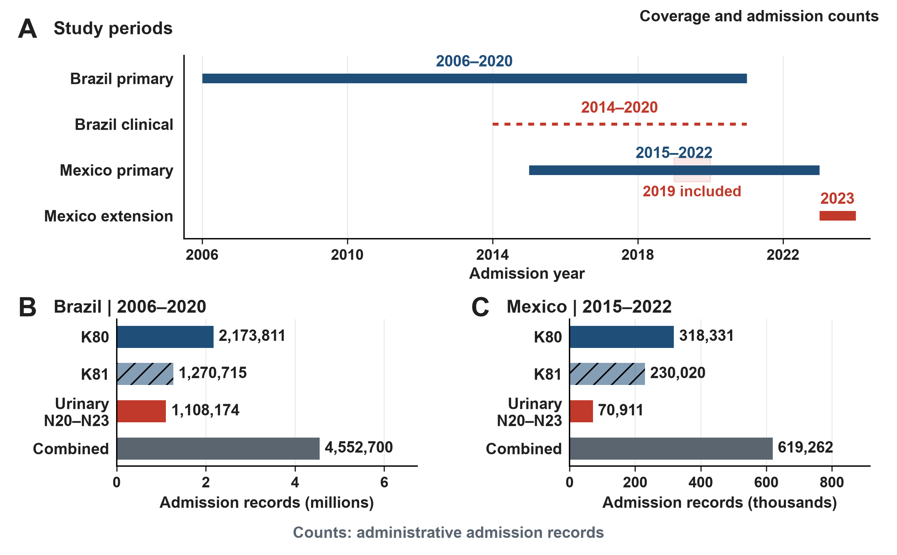
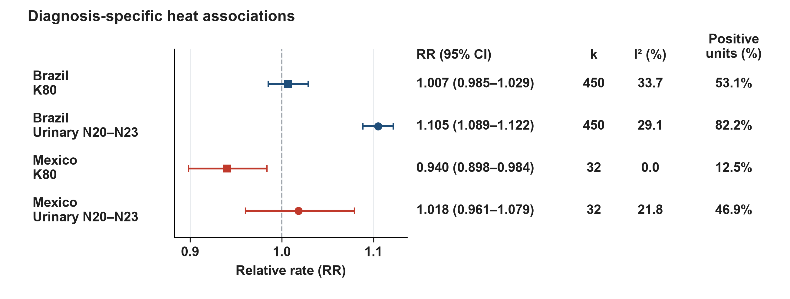
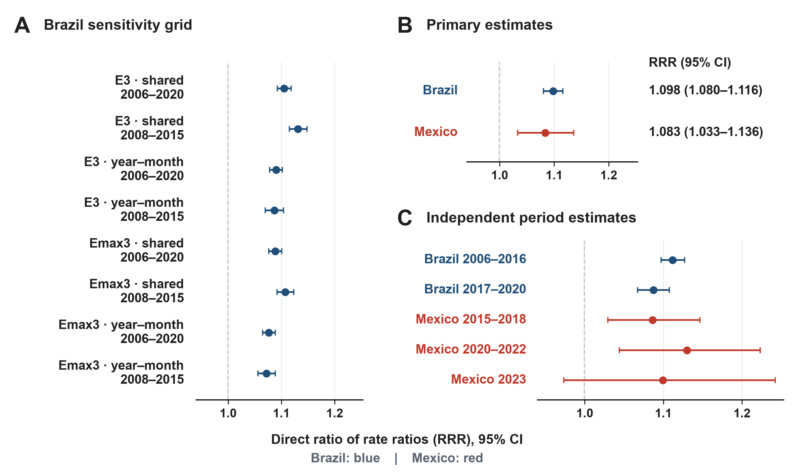
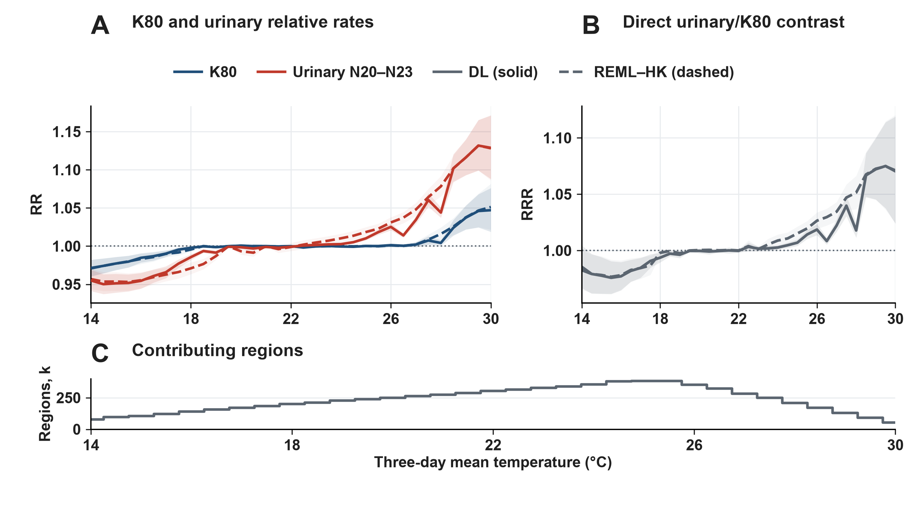

# 巴西和墨西哥短期高温与住院记录：尿路结石及未特指肾绞痛与胆囊和胆管结石的直接比较

冯硕¹，史超¹，刘天明¹，丁浩然¹，杭丰贺¹，黄政豪¹，孟宪志¹*

¹ 哈尔滨医科大学附属第一医院肝脾外科省重点实验室，哈尔滨，中国

* 通讯作者：孟宪志；电子邮箱：[mengxianzhi@hrbmu.edu.cn](mailto:mengxianzhi@hrbmu.edu.cn)

## 摘要

尿路结石或未特指肾绞痛住院记录与胆囊或胆管结石住院记录之间的短期高温关联是否存在差异？这种差异能否在巴西和墨西哥观察到？我们分析了巴西450个卫生区域（2006–2020年）和墨西哥32个州（2015–2022年）的行政住院记录。联合准泊松模型比较各地区三日平均气温第95百分位与中位数对应的关联，并对两种诊断采用相同的当地气温。直接估计的率比之比（RRR）用于比较两种诊断的温度关联，在巴西为1.098（95% CI 1.080–1.116），在墨西哥为1.083（1.033–1.136）。两国的对比方向一致，但各诊断的模式不同。巴西在较高气温下尿路相关住院记录更多，胆囊或胆管结石的估计值接近无关联值。墨西哥在较高气温下胆囊或胆管结石记录较少，而尿路诊断的估计值接近无关联值，且其区间包含1。在巴西临床亚队列中，严格N20与K80的诊断间对比在急诊住院中大于择期住院；正式交互作用估计值为1.156（1.086–1.232）。因此，相似的相对对比可能对应不同的诊断特异性住院模式。研究应同时报告直接对比和各诊断的关联，并认识到行政记录无法区分疾病发生与就医及住院决策。

## 引言

本研究的两个结局为尿路结石或未特指肾绞痛（ICD-10 N20–N23）住院，以及胆囊或胆管结石（ICD-10 K80）住院；K80作为一个合并诊断组。既往研究发现，短期环境气温与美国城市的临床肾结石就诊及安大略省肾绞痛急诊医疗记录存在关联[1,2]。南卡罗来纳州的基于人群研究及首尔的时间序列研究考察了尿路结石急诊就诊[3,4]。广州和库内奥的研究涉及肾绞痛及尿路结石，但诊断定义和就诊场景各有差异[5,6]；阿德莱德的研究则在更广泛的肾脏疾病类别中考察尿路结石[7]。巴西研究分析了住院记录与月度气候变化的关系，近期还使用了州–月份尺度的高温指标[8,9]。胆道疾病研究采用的结局也不相同，包括日本急性胆囊炎住院，以及马德里肝胆疾病研究中紧急收治的K80–K81病例[10,11]。Malig及其同事已在加利福尼亚州暖季非计划住院研究中同时考察尿路结石和更广义的胆道类别[12]。在相同的当地气温对比下，两组的短期高温关联是否不同？这种差异的方向能否在两个卫生系统中观察到？

分别估计每种诊断的关联，再比较其是否达到统计学显著，并不能检验两种关联是否存在差异[13,14]。直接交互对比可以回答这一问题[15]。我们采用联合模型，使两种诊断组共享各自地理单元的参照气温，并在报告相对差异的同时报告各诊断的关联。共同参照值根据各地区或州当地气温确定，并非两国共享的某个绝对气温。解释这一比较时，两部分信息缺一不可。相对对比高于1，可能源于高温时尿路住院记录增加、胆结石住院记录减少，或两种情况同时发生。即使相对对比方向一致，这些情形的临床含义也不同。

本研究的主要目标是利用巴西和墨西哥的行政住院记录，直接比较两种诊断组的短期高温关联，并评估诊断对比在两国是否方向一致。随后，我们考察这种一致性是否同时对应相似的诊断特异性住院模式。次要分析比较了巴西临床亚队列中的急诊住院与择期住院。

## 材料与方法

### 研究设计、数据来源与结局

我们开展了一项时间序列研究，使用巴西SIH-SUS住院记录和墨西哥DGIS/SAEH记录[16,17]。巴西数据涵盖2006–2020年的450个卫生区域；墨西哥数据涵盖2015–2022年的32个州，包括2019年（图1A；表1）。记录按居住地地理单元和入院日期归属：巴西采用居住地市镇和DT_INTER，墨西哥采用惯常居住州ENTIDAD和INGRE。计数单位为纳入系统中的一条行政住院记录。巴西数据涵盖由公共资金支付的SIH-SUS医疗服务，墨西哥数据涵盖所选SAEH文件中的医疗机构。

主要对比依据主要诊断确定：尿路结石或未特指肾绞痛定义为N20–N23，胆囊或胆管结石定义为K80[18]。K80作为一个合并组分析。K81指急性、慢性或未特指胆囊炎，不能确定存在结石性疾病；主要联合模型将其作为第三个结局纳入，但它既不是主要比较的分子，也不是分母。由于记录数量存在不连续变化，排除了K85。补充方法中列出了详细编码定义及排除K85的依据。

对于墨西哥，我们按每个数据来源年份选取一个文件，并依据入院日期保留记录，包括出现在后续来源文件中的住院记录。年度文件主要基于出院记录，因此来源年份和入院年份分别处理。我们排除了无效入院日期或居住地编码的记录。我们考察了来源年份与出院年份的一致性，以及精确匹配和非ID候选记录匹配，并将保守的候选重复记录排除作为敏感性分析。2023年扩展分析还使用了2024年出院来源数据进行下一年度随访。巴西临床分析将入院日期限定在2014–2020年，并比较了处理来源年份为2014–2021年与2014–2020年的结果。表S1记录了来源选择、记录重建和排除情况。缺失的健康观测仍按缺失处理；实际观测到的零住院日仍记为零。

### 温度暴露与共享的当地对比

每日气温取自ECMWF再分析场[19,20]。巴西采用人口加权的ERA5-Land气温。墨西哥在各州边界范围内，对有效陆地网格采用余弦纬度面积权重；扩展分析沿用已归档的网格和聚合方法。每个UTC日内的逐小时观测取平均。墨西哥历史文件的表头与ERA5-Land一致，但无法取得原始数据检索请求。空间权重在可用观测范围内归一化：

`X = Σ(w × x × valid) / Σ(w × valid)`.

其中，x为网格气温，w为相应的空间权重，valid表示观测是否可用。该分母使部分网格缺失时仍能维持气温的量纲。主要暴露E3为入院当日及此前两个实际日历日气温的平均值。在结局和时间段筛选之前构建暴露历史；不完整的时间窗予以排除。

各单元的P95和中位数根据其全部符合主要分析条件的E3分布计算，并由不同诊断共享。这些目标值不按年份或季节重新计算。温度反应采用三列自然样条，内部结点位于各单元E3的三分之一和三分之二分位数，边界结点位于观测到的最小值和最大值；预测时重复使用拟合得到的基函数[21]。表S2使用R type 7经验分位数总结各单元的目标分布[22]。临床分析和入院来源分析依据各自符合条件的分析日历，定义共享目标值和基函数。

### 联合模型、直接诊断对比与不确定性

在每个单元内，将K80、K81和N20–N23的日计数堆叠后纳入带log链接的准泊松模型。时间序列调整考虑了星期、月份和较长期变化[23]：

`log μ_ort = α_or + B(E_rt)'β_or + weekday_or(t) + month_or(t) + ns(time,12)_or + offset_rt`.

诊断交互项允许三种结局的暴露、星期、月份和12自由度时间趋势各自不同。巴西模型将区域人口对数作为偏置项。墨西哥模型不含人口偏置项，估计州内住院记录数的相对变化。纳入标准为至少250个暴露完整且三种结局均完整的共同日期，并且每种结局至少有40个事件。因此，尽管表2仅报告K80、尿路诊断及其直接对比，K81仍会影响纳入资格。未收敛或数值无效的拟合按相同标准排除。

单元特异性对数率比之比为

`δ_r = [B(P95_r) − B(M_r)]' (β_urinary,r − β_K80,r)`.

对δ_r取指数即得到RRR：在联合模型内，尿路组P95相对于中位数的率比与相应K80率比之比。其方差采用完整的联合系数协方差矩阵，包括诊断间协方差。我们还从同一组拟合中提取各诊断的RR。分别合并的诊断特异性RR使用各自的权重，不能通过相除来重建直接合并的RRR。

将各诊断的日得分相加，并按实际日期对齐。单元协方差采用带14个日滞后的Bartlett异方差及自相关稳健估计（HAC14），不再乘以第二个准泊松离散度因子[24,25]。单元-日聚类用于处理同一天不同诊断行之间的相关性；滞后项还用于处理不同日期之间的相关性。各单元的对数对比在国家内分别采用DerSimonian–Laird（DL）随机效应模型合并[26]。REML结合Hartung–Knapp推断作为替代方法[27,28]。我们报告地理单元数k、I²，以及单元对数对比大于零的比例[29]。最后一项反映方向，不代表统计学显著性。

主要国家区间保留DL点估计和观测权重。我们在相同日历上对经DL加权并归一化的单元影响值求和，并采用Bartlett HAC14，然后加入模型化的单元间分量，即τ²乘以归一化权重平方和。这些区间以观测权重和异质性为条件。表S3列出协方差替代方案；表S4列出在独立单元区间和同步区间下对齐的边际对比与直接对比。按日配对的HC0、基于模型的协方差、HAC28/HAC90，以及仅作同步条件处理的区间均作为敏感性分析。

### 临床次要分析

严格编码对比用于评估广义尿路定义是否解释了主要模式。我们分别考察N20、N20–N21和N23，并分析结石相关胆道诊断；K80.3归为胆管炎，不统一标为急性。在巴西，急诊住院和择期住院分别对应CAR_INT 02和01；其他或未知值单独保留。我们在这两类住院中，针对N20和K80拟合包含四个结局的联合模型，以估计暴露×诊断×入院类型交互作用。纳入条件为至少400个符合暴露条件的日期、至少两个不同的E3取值，以及每个结局类别均有正计数。各分层RRR和正式交互作用基于相同的成功联合拟合地区及完整协方差计算，并分别采用相应的合并权重。在墨西哥，PROCED 2表示来源为急诊科，PROCED 1表示来源为门诊。经核实的字典适用于2016–2022年；本对比排除了2015年。这些来源类别与巴西的入院紧急程度不同（表S5）。表S6详细列出严格编码和入院类别的定义。

成人病例构成分析在六个年龄-性别分层中比较广义N20–N23与K80：18–44岁、45–64岁和65岁及以上，分别按性别分层。每个单元要求至少有400天，且每个年龄-性别-诊断单元格至少有30例。两种诊断采用基于合并成人病例计算的相同国家层面固定权重：

`RRR_std = [Σ_s w_s RR_urinary,s] / [Σ_s w_s RR_K80,s]`.

这是分层特异性RR的加权算术平均值之比。Delta法方差采用12个对数对比按日期对齐后的完整协方差，并将观测病例权重视为固定值。后续处理来源队列沿用巴西匹配来源的成人权重；采用优选队列权重和均匀权重进行敏感性分析。在相同的成功分析单元、日期和温度目标上比较标准化与未标准化估计值（表S7）。该分析描述成人病例构成，并与严格编码的入院紧急程度交互作用分析分开。表S8列出临床及其他针对性比较的拟合覆盖范围。

### 敏感性与探索性分析

巴西八格分析网格组合E3与每日最高气温的三日均值、两种日历模型，以及2006–2020年与2008–2015年两个时段（表3）。一种日历模型在不同诊断间共享星期、月份和12自由度时间趋势系数，同时保留诊断特异性暴露反应。另一种模型采用诊断特异性星期和年-月份固定效应，并拟合准泊松广义线性模型。网格中的“全时段”指2006–2020年；其中共享日历模型与主要分析采用的诊断特异性日历模型不同。滚动时间窗涵盖滞后0–2、0–6、0–13和0–20天。核心设定汇总于表S9；墨西哥排除2019年的对照队列、疫情年份分析和逐州剔除检查列于表S10。

灵活日历模型以每个分析年份6个自由度的连续自然时间样条、星期和全国性节假日，替代月份类别及全时段趋势，且各项均按诊断分别建模。该模型保留主要温度目标和基函数。排除2020年的巴西入院紧急程度分析则单独保留原有的诊断特异性星期、月份和12自由度趋势，同时采用完整临床时段的目标值和基函数。共同成功分析的比较将设定改变与拟合单元改变区分开来（表S11）。参考既往同时考察气温与湿度的尿路结石研究[30]，我们采用匹配样本湿度模型，在保留温度目标、基函数和日历项的同时，加入诊断特异性的三自由度三日露点或相对湿度样条（表S12）。湿度在空间聚合后计算，因此不同于网格湿度的平均值。

分布滞后非线性模型使用滞后0–21天的原始每日平均气温[31]。将三自由度温度样条与三自由度滞后样条交叉，滞后内部结点位于√21处，边界为0和21。分析要求至少400个完整历史配对日期，且每个终点至少有40个事件；累积协方差采用按日历对齐的HAC28。其持续每日气温历史使用主要分析E3的数值P95和中位数，这是不同于主要滚动均值对比的暴露历史（表S13）。完整的基函数和预测细节见补充方法。

巴西采用独立时段模型，分别重新拟合2006–2016年和2017–2020年的数据；墨西哥则分别重新拟合2015–2018年、2020–2022年和2023年的数据。固定目标重新拟合保留全时段的数值气温和拟合基函数；按时段设定参照值的替代分析改变目标值，但保留基函数。表S14列出局部支持和共同单元的结果。探索性诊断特异性分析将P95与限制在P10–P60范围内的拟合最低风险温度（MRT）比较，要求至少400天和100个事件。其区间以所选最低点为条件。单元系数模拟在固定的2,001点网格上，通过1,000次抽样重新选择MRT（表S15；图S1）。这一不同参照值不取代以共享中位数为参照的主要比较。

### 暴露-反应曲线与绝对计数情景

针对每个气温值，仅当巴西地区的E3处于其P2–P98范围内，且±1 °C范围内至少有30个符合条件的日期时，该地区才纳入曲线估计。DL和剖面REML–Hartung–Knapp估计采用相同的贡献地区，并计算点态95%区间。贡献地区、权重和异质性可能随气温改变；因此，绘制的曲线整合了来自不断变化的地理单元集合的局部对比。表S16列出有支持地区和所有成功单元的估计值；表S17列出曲线支持度和加权诊断。主图显示至30 °C。

巴西绝对计数情景比较了在各地区E3分别设为当地P95或中位数时，模型预测的每日记录数，并对观测到的日历和人口协变量取平均。我们对各诊断的地区变化量求和，并直接估计尿路与K80变化量之差。不确定性估计采用完整的预测差梯度，以及基于同步日影响值的HAC14。该情景将相对关联转换为每日住院记录尺度。

## 结果

### 研究覆盖范围与诊断直接对比

主要分析涵盖450个巴西卫生区域和32个墨西哥州，符合暴露条件的单元日分别为2,464,415和93,440。完整健康日历中，巴西有2,173,811条K80住院记录和1,108,174条尿路住院记录；墨西哥相应数量为318,331和70,911（图1B、C；表1）。单元特异性P95与中位数之间温差的中位数在巴西为3.51 °C（IQR 2.84–3.96），在墨西哥为3.68 °C（2.96–4.51）（表S2）。

## 表1

两国主要队列的覆盖范围、诊断计数和暴露描述。日历单位日与暴露合格单位日并不相同；分别列出健康记录缺失的单位日和零住院合格日。住院总数按完整健康日历统计，覆盖全部日历单位日，而非仅暴露合格日；计数为住院记录数，而非独立人员数。E3百分位数描述合并的合格单位日。目标温差汇总的是已定义的单位特异P95减中位数对比；其跨单位中位数和四分位数采用经验型7分位数。

| 特征 | 巴西，主要队列2006–2020年 | 墨西哥，首选队列2015–2022年 |
| --- | --- | --- |
| 地理单位数 | 450 | 32 |
| 日历单位日 | 2,465,550 | 93,504 |
| 日历日期数 | 5,479 | 2,922 |
| 暴露合格单位日 | 2,464,415 | 93,440 |
| 健康记录缺失单位日 | 1,135 | 0 |
| 零住院单位日（健康日历） | 990,206 | 7,300 |
| 零住院合格单位日 | 990,206 | 7,289 |
| E3平均温度（°C） | 23.34 | 20.60 |
| E3温度中位数（°C） | 24.04 | 20.83 |
| E3温度P05（°C） | 16.17 | 12.34 |
| E3温度P95（°C） | 28.49 | 28.26 |
| 单位特异P95减中位数温差，中位数（四分位距；°C） | 3.51（2.84–3.96） | 3.68（2.96–4.51） |
| K80住院记录 | 2,173,811 | 318,331 |
| K81住院记录 | 1,270,715 | 230,020 |
| 泌尿系统N20–N23住院记录 | 1,108,174 | 70,911 |

### 图1

数据覆盖与各诊断住院记录。A，巴西主要入院时段（2006–2020年；k=450）、墨西哥主要时段（2015–2022年；k=32）、巴西临床分析时段（2014–2020年）及墨西哥2023年独立扩展时段。墨西哥主要队列包括2019年，对照队列排除该年。B、C，K80、K81、N20–N23及三类诊断合计的住院记录，两国采用各自的计数刻度。K80合并胆囊或胆管结石；K81为胆囊炎；N20–N23包括尿路结石和未特指肾绞痛。墨西哥完整日历含93,504个州–日，其中7,300个为零住院日；93,440个州–日具有完整暴露窗口。计数单位为行政住院记录；k为纳入的地区或州数。

对于相同的当地P95与中位数气温对比，直接估计的尿路相对于K80的RRR在巴西为1.098（95% CI 1.080–1.116），在墨西哥为1.083（1.033–1.136）（表2）。单元层面的I²分别为21.1%和30.3%，对比值为正的单元分别占76.4%和62.5%。

诊断特异性估计解释了为何相对对比方向相同，但两国模式不同。在巴西，较高气温与尿路结石或未特指肾绞痛住院记录增加相关：RR为1.105（1.089–1.122）；胆囊或胆管结石住院记录的RR为1.007（0.985–1.029）。在墨西哥，K80的RR为0.940（0.898–0.984），尿路诊断的RR为1.018（0.961–1.079）（图2）。因此，墨西哥尿路诊断的区间包含1，而K80估计值低于1。

### 图2

共享当地温度对比下各诊断的关联。每个点为国家层面合并的率比（RR），比较各单元三日平均气温（E3）的第95百分位数（P95）与中位数。同一国家内两类诊断采用相同的地理单元（巴西k=450；墨西哥k=32）。方形代表K80（胆囊或胆管结石），圆形代表尿路N20–N23（尿路结石或未特指肾绞痛）；蓝色为巴西，红色为墨西哥。误差线为同步95%置信区间，采用含14个日滞后的异方差与自相关稳健协方差（HAC14），并加入DerSimonian–Laird（DL）合并的模型化单元间分量。k为地理单元数，I²描述单元间异质性。I²与正向单元比例依次为：巴西K80，33.7%与53.1%；巴西尿路诊断，29.1%与82.2%；墨西哥K80，0.0%与12.5%；墨西哥尿路诊断，21.8%与46.9%。这些统计量基于单元HAC14估计；正向单元指RR>1。表2列出各估计及直接合并的率比之比（RRR）；分别合并的边际RR不能相除重建直接RRR。

## 表2

主要联合拟合单位集合中，按国家对齐的边际RR及直接估计的泌尿系统相对于K80的RRR；各单位均使用P95与共同中位数进行比较。边际RR保留终点特异的合并权重，相除不能还原直接合并的RRR。区间为报告的日历同步Bartlett HAC14推断，并加入经建模的DL单位间成分，且以观测权重和异质性为条件。k、I²和正向单位方向为报告的单位层面汇总。

| 国家/终点 | RR或直接RRR（95%置信区间） | k | I²（%） | 方向>0（%） |
| --- | --- | --- | --- | --- |
| 巴西 &#124; K80 | 1.007（0.985–1.029） | 450 | 33.7 | 53.1% |
| 巴西 &#124; 泌尿系统N20–N23 | 1.105（1.089–1.122） | 450 | 29.1 | 82.2% |
| 巴西 &#124; 直接泌尿系统相对于K80的RRR | 1.098（1.080–1.116） | 450 | 21.1 | 76.4% |
| 墨西哥 &#124; K80 | 0.940（0.898–0.984） | 32 | 0.0 | 12.5% |
| 墨西哥 &#124; 泌尿系统N20–N23 | 1.018（0.961–1.079） | 32 | 21.8 | 46.9% |
| 墨西哥 &#124; 直接泌尿系统相对于K80的RRR | 1.083（1.033–1.136） | 32 | 30.3 | 62.5% |

**附加面板：巴西标准化每日绝对计数情景。** 这些报告的面板汇总比较同时设定当地P95与当地中位数；它们不是全国高温事件的观测总量。

| 终点 | 每日计数差（95%置信区间） | 纳入地区数 |
| --- | --- | --- |
| K80 | -0.2（-8.5–8.1） | 450 |
| 泌尿系统N20–N23 | 19.3（16.1–22.5） | 450 |
| 泌尿系统减K80 | 19.5（13.1–25.8） | 450 |

### 入院类别、诊断定义与成人病例构成

在巴西临床亚队列中，严格定义的N20与K80对比在急诊住院中大于择期住院。在相同的411个联合拟合地区中，各分层RRR分别为1.139（1.111–1.166）和0.998（0.951–1.048）。直接估计的交互作用为1.156（1.086–1.232），I²=67.4%，交互作用为正的地区占62.5%（表4）。灵活日历分析和固定目标、排除2020年的分析也得到正向交互作用，分别基于242和412个拟合地区（表S6、S8和S11）。

在墨西哥，将尿路定义缩窄至N20后，对比仍为正：1.091（1.036–1.150）。N20–N21对比为1.078（1.028–1.131），单独考察的N23组为1.150（1.034–1.280）（表4；表S7）。入院来源对比按字典支持的时段另行报告（表S5）。

在匹配分析样本中，成人病例权重标准化使点估计发生小幅变化。巴西的未标准化和标准化RRR分别为1.113（1.095–1.131）和1.099（1.079–1.119）；墨西哥分别为1.065（0.987–1.148）和1.055（0.964–1.155）。这些比较涵盖208/450个巴西地区和16/32个墨西哥州。墨西哥两组区间均包含1（表4；表S7）。

### 日历设定、暴露窗口与独立时段比较

巴西网格中的八项估计均高于1，范围为1.072至1.131；主要分析的RRR为1.098（图3A、B；表3a）。在不同日历假设下，共享日历网格分析与主要模型的对比方向相似。在滚动时间窗分析中，巴西RRR始终高于1。在排除2019年的墨西哥对照队列中，E3和E21的估计值分别为1.090（1.043–1.140）和1.059（1.011–1.109）（表3b）。针对另行定义的持续气温历史，分布滞后模型的累积RRR在巴西为1.144（1.120–1.168），在完整墨西哥队列为1.087（1.007–1.173）（表S13）。

替代的诊断特异性日历模型仍保留正向对比。巴西灵活日历模型的估计值为1.088（1.076–1.101），基于422个成功拟合地区。墨西哥的年-月份模型和灵活日历模型估计值分别为1.086（1.034–1.141）和1.086（1.032–1.143）（表4；表S11）。将墨西哥记录限制为来源年份与出院年份一致，或保守排除候选重复记录后，合并对比基本不变（表S1）。

较早和较晚时段重新拟合的点估计也为正；在较短的墨西哥时段中，区间较宽（图3C；表S14）。墨西哥2023年独立重新拟合纳入下一年度出院随访，结果为1.096（0.970–1.238），其区间包含1。

### 图3

不同设定与时段中的尿路相对于K80的直接对比。率比之比（RRR）在联合模型内直接比较尿路N20–N23与K80各自的温度关联率比。各项对比均采用单元内P95（第95百分位数）与共同中位数。A，巴西E3或Emax3、共同日历或诊断特异年–月份调整、2006–2020年或2008–2015年的八种组合。E3为日平均气温的三日均值，Emax3为日最高气温的三日均值。共同日历指各诊断共享日历系数，暴露反应仍随诊断变化，因此不同于主要模型。B，两国主要估计：巴西k=450、I²=21.1%、正向单元76.4%；墨西哥k=32、I²=30.3%、正向单元62.5%。C，独立时段重新拟合，包括采用2015–2022年数值温度参照并纳入次年出院随访的墨西哥2023年分析。点为DerSimonian–Laird（DL）估计，误差线为95%置信区间，各面板采用相同的横轴数值范围。主要区间采用同步HAC14加模型化DL分量；网格和时段区间采用单元HAC14与DL推断。HAC14为含14个日滞后的异方差与自相关稳健协方差。k为地区或州数，I²描述单元间异质性；正向单元指RRR>1。所有估计均为直接率比之比，不是风险差。表S9逐项列出图中估计、区间、k、I²与正向比例；表S14列出时段支撑情况。

## 表3

巴西八格敏感性网格（面板a）和滚动暴露窗口（面板b）的敏感性估计。所有结果均为DL/HAC14合并的泌尿系统相对于K80的直接RRR。面板a按暴露、日历设定和时段列出八种组合。面板b按国家逐行列出四种滚动窗口；墨西哥使用排除2019年的比较队列。分布滞后累积对比的估计目标不同。

“共同日历”指各诊断共享星期、月份和时间平滑趋势系数，暴露系数仍随诊断变化；年–月份固定效应随诊断变化。全时段网格中的共同日历模型不同于主要分析的诊断特异平滑趋势模型。

### a. 巴西八格网格

| 暴露 | 日历设定 | 时段 | 直接RRR（95%置信区间） | k | I²（%） | 正向单位（%） |
| --- | --- | --- | --- | --- | --- | --- |
| E3 | 共同日历 | 2006–2020年 | 1.105（1.092–1.118） | 450 | 36.3 | 72.2% |
| E3 | 共同日历 | 2008–2015年 | 1.131（1.115–1.148） | 446 | 28.7 | 75.1% |
| E3 | 结局特异年-月份固定效应 | 2006–2020年 | 1.090（1.078–1.102） | 450 | 16.3 | 75.1% |
| E3 | 结局特异年-月份固定效应 | 2008–2015年 | 1.087（1.070–1.104） | 446 | 15.4 | 63.9% |
| Emax3 | 共同日历 | 2006–2020年 | 1.089（1.076–1.101） | 450 | 32.4 | 71.8% |
| Emax3 | 共同日历 | 2008–2015年 | 1.107（1.092–1.123） | 446 | 25.4 | 70.0% |
| Emax3 | 结局特异年-月份固定效应 | 2006–2020年 | 1.077（1.065–1.089） | 450 | 23.4 | 70.4% |
| Emax3 | 结局特异年-月份固定效应 | 2008–2015年 | 1.072（1.056–1.089） | 446 | 17.5 | 64.6% |

### b. 滚动暴露窗口

| 窗口 | 巴西主要队列（2006–2020年） | 墨西哥比较队列（排除2019年） |
| --- | --- | --- |
| E3 | RRR 1.098（1.086–1.110） k=450；I²=21.1%；正向单位76.4% | RRR 1.090（1.043–1.140） k=32；I²=18.5%；正向单位71.9% |
| E7 | RRR 1.111（1.097–1.125） k=450；I²=31.9%；正向单位75.3% | RRR 1.089（1.038–1.142） k=32；I²=19.9%；正向单位68.8% |
| E14 | RRR 1.106（1.090–1.122） k=450；I²=36.6%；正向单位71.1% | RRR 1.076（1.030–1.124） k=32；I²=0.0%；正向单位65.6% |
| E21 | RRR 1.105（1.088–1.123） k=450；I²=39.0%；正向单位68.2% | RRR 1.059（1.011–1.109） k=32；I²=0.0%；正向单位56.2% |

### 湿度调整、气温曲线与每日计数情景

在匹配样本中调整湿度后，两国的诊断对比均有所减弱，但方向仍为正（表S12）。巴西的露点和相对湿度估计值分别为1.085（1.073–1.098）和1.087（1.073–1.101）。采用DL时，墨西哥相应的估计值为1.077（1.022–1.136）和1.063（1.001–1.129）。对于墨西哥相对湿度，REML–Hartung–Knapp估计值为1.063（0.999–1.131），区间跨越1（表4）。匹配单元比较有助于区分这些变化与地理覆盖范围变化。

在当地支持范围内，巴西曲线显示较暖气温下尿路诊断的关联大于K80（图4A）。在所显示范围的较高温端，直接RRR曲线也高于1；不过DL与剖面REML–Hartung–Knapp估计的局部变化有所不同（图4B）。贡献地区数量随气温变化，到30 °C时降至54个地区（图4C）。有支持地区和所有成功单元的曲线及加权诊断列于表S16和S17。采用不同参照值的探索性P95与MRT结果另见图S1和表S15。

在巴西模型情景中，与中位数相比，将各地区E3设为当地P95后，直接估计的尿路与K80变化量之差为**每天19.5条模型预测住院记录（95% CI 13.1–25.8）**。诊断特异性变化量方面，尿路记录为19.3（16.1–22.5），K80为−0.2（−8.5–8.1）（表2）。

### 图4

具有当地暴露支撑的巴西暴露–反应曲线。A，K80（蓝色）与尿路N20–N23（红色）相对于各地区共同中位数的率比（RR），采用相同纵轴。B，直接估计的尿路相对于K80的率比之比（RRR）。实线及较深阴影为DerSimonian–Laird（DL）估计与逐点95%置信区间；虚线及较浅阴影为轮廓限制性最大似然估计结合Hartung–Knapp推断（REML–HK）及其区间。C，贡献地区数（k），两类诊断与两种合并方法采用相同的地区集合。温度须位于地区三日平均气温（E3）的P2–P98内，且±1 °C内至少有30个符合条件的日期。P2与P98分别为当地第二和第九十八百分位数；贡献地区与权重随温度变化。30 °C时k=54，DL的I²/正向单元比例依次为：K80，8.0%/66.7%；尿路诊断，23.3%/77.8%；直接RRR，13.5%/68.5%。I²描述地区间异质性；正向地区指RR或RRR>1。32 °C附近±1 °C内有144/450个地区及7,002个地区–日，但仅一个地区满足曲线支撑规则，因此不展示该尾部。曲线交叉不是生物学阈值。完整数值与权重诊断见表S16及S17。

## 表4

日历、表型、成年病例桥接、急诊及湿度比较。日历、表型、成年病例和急诊行使用单位HAC14对比及独立单位DL合并；湿度行保留其标注的来源推断方法。以上结果不同于表2中的同步主要区间；置信区间与所列模型对应。急诊交互作用由联合模型估计，并非通过分别合并各层后相除得到。表S8列出全部21行的尝试、拟合、失败和不合格单位数、共同成功分母及选定子集大小。2023年估计为时段重拟合，而非预测验证。

| 情景/对比 | 效应（95%置信区间） | k | I²（%） | 方向>0（%） |
| --- | --- | --- | --- | --- |
| 巴西：灵活日历与假日 | 1.088（1.076–1.101） | 422 | 24.3 | 75.1% |
| 墨西哥：年月固定效应 | 1.086（1.034–1.141） | 32 | 30.3 | 68.8% |
| 墨西哥：灵活日历与假日 | 1.086（1.032–1.143） | 32 | 39.5 | 62.5% |
| 墨西哥：2023年时段重拟合 | 1.096（0.970–1.238） | 30 | 50.0 | 63.3% |
| 巴西：急诊N20/K80 | 1.139（1.111–1.166） | 411 | 25.1 | 67.4% |
| 巴西：择期N20/K80 | 0.998（0.951–1.048） | 411 | 68.2 | 48.2% |
| 巴西：急诊/择期交互 | 1.156（1.086–1.232） | 411 | 67.4 | 62.5% |
| 巴西：交互，灵活日历 | 1.153（1.102–1.206） | 242 | 34.2 | 66.9% |
| 巴西：排除2020年，固定目标 | 1.184（1.106–1.266） | 412 | 64.8 | 61.7% |
| 墨西哥：N20/K80 | 1.091（1.036–1.150） | 32 | 33.8 | 71.9% |
| 墨西哥：N20–N21/K80 | 1.078（1.028–1.131） | 32 | 29.0 | 59.4% |
| 墨西哥：N23/K80 | 1.150（1.034–1.280） | 31 | 0.0 | 64.5% |
| 巴西成人：未标准化 | 1.113（1.095–1.131） | 208 | 23.5 | 82.7% |
| 巴西成人：共同病例权重标准化 | 1.099（1.079–1.119） | 208 | 25.9 | 77.9% |
| 墨西哥成人：未标准化 | 1.065（0.987–1.148） | 16 | 47.9 | 68.8% |
| 墨西哥成人：共同病例权重标准化 | 1.055（0.964–1.155） | 16 | 55.8 | 62.5% |
| 巴西：露点调整 | 1.085（1.073–1.098） | 450 | 19.5 | 70.0% |
| 巴西：相对湿度调整 | 1.087（1.073–1.101） | 450 | 18.6 | 68.0% |
| 墨西哥：露点调整 | 1.077（1.022–1.136） | 32 | 40.9 | 62.5% |
| 墨西哥：相对湿度，DL | 1.063（1.001–1.129） | 32 | 42.9 | 56.2% |
| 墨西哥：相对湿度，REML–HK | 1.063（0.999–1.131） | 32 | 42.9 | 56.2% |

## 讨论

巴西和墨西哥的尿路相对于K80温度直接对比方向相同，但对应的诊断特异性住院模式不同。巴西在较高气温下尿路住院记录更多，而胆囊或胆管结石（ICD-10 K80）住院记录的估计值接近无关联值。墨西哥在较高气温下K80记录较少，尿路诊断的估计值则接近无关联值，且区间包含1。仅报告相对对比会掩盖关联更明显的是哪种诊断。两国一致的是诊断间对比的方向。

Malig及其同事开展的加利福尼亚研究是最接近的先前比较：该研究在暖季非计划住院病例中考察了尿路结石和更广义的胆道类别[12]。本研究使用全年记录及明确界定的K80组，在相同的当地气温下比较两种诊断，并直接估计其差异。除报告这一对比外，同时报告两种诊断各自的关联，显示了巴西和墨西哥不同的模式。巴西气候与住院记录的研究为尿路诊断的正向关联提供了背景，但其时间聚合方式和高温指标不同[8,9]。日本气温研究关注急性胆囊炎，因此其结果应与K80结果结合考量，而不能视为等同[10]。马德里分析同样纳入了合并K80–K81的急诊住院类别[11]。比较温度关联时，诊断定义和入院场景的差异十分重要。

巴西入院紧急程度分析进一步揭示了临床差异：严格定义的N20与K80对比在急诊住院中大于择期住院，正式联合交互分析也支持这一差异。急诊住院是医院对收治情况的分类，而急诊科就诊记录的是不同的医疗环节。肾绞痛指南涉及症状管理和干预决策[32]。胆石症指南则区分有症状疾病及其并发症[33]。因此，症状出现后的时间、转诊和住院决策均可能影响观察到的记录。急性胆囊炎临床指南关注的是比合并K80组更具体的炎症表现[34]。成人病例构成分析采用更广义的尿路诊断，且地理样本较小；它与严格N20住院紧急程度交互作用分析属于不同的诊断和样本比较。

脱水与尿液浓缩可能影响尿路症状出现的时间。尿液成分研究考察了与气温相关的变化[35]。临床对结石疾病的描述则区分了基础结石形成与症状表现[36]。胆道结石疾病具有自身的病理生理过程和临床进程[37]。这些因素可用于提出有关不同临床表现模式的假设，但不能解释墨西哥K80关联的方向。特别是，较高气温下K80住院记录较少，并不意味着结石形成减少。

不同卫生系统之间的对比也要求关注医疗服务如何进入行政记录。巴西的公共支付体系与墨西哥卫生服务组织在覆盖范围和可及性安排上存在差异[38,39]。因此，纳入的记录、主要诊断编码和入院类别分别反映了各系统中实际观察到的医疗服务。常规收集数据报告指南强调应透明说明编码定义和样本选择程序；当广义肾绞痛组与胆结石组进行比较时，这些信息尤为重要[40]。墨西哥严格编码分析仍显示正向对比，而精确度较低的成人和分时段估计则说明证据范围较窄。研究结果支持报告诊断细节和分析覆盖范围，而不应将研究简化为一个合并的“结石住院”关联。

### 局限性

本项生态学分析将地区层面的室外气温与行政住院记录相关联。个体暴露和易感性可能不同于地区平均水平，这是生态学研究中常见的情况[41]。这些记录无法区分疾病发生、症状出现时间、就医、转院和住院决策，也不含影像学判定或机制测量。来源记录比较可描述数据文件，但无法确定独立患者或临床事件。K80合并了胆囊和胆管结石；N20–N23合并了尿路结石与未特指肾绞痛。

两国在覆盖范围、编码和温度加权方式上存在差异。墨西哥纳入32个州，不含人口偏置项，并保留了疫情年份。临床分析涵盖的时期较短，或仅纳入部分成功拟合单元；成人比较仅包括16个墨西哥州。独立时段分析重新拟合了关联，部分时段的精度有限。部分次要分析是在获得较早结果后设计的；本研究未进行前瞻性注册，也未实施全面的多重性校正。这些分析用于补充主要比较，性质上属于探索性分析。

国家合并区间以估计的合并权重和异质性为条件，其HAC带宽及模型化的单元间分量均依赖推断假设。各地理单元的对比方向并不一致。曲线贡献地区及其权重随气温变化，因此上尾形态和局部变化可能受支持范围和合并方法影响。所选MRT区间还以拟合得到的最低点为条件。绝对计数结果是在不同的当地百分位气温下进行的模型化每日比较，并非观察到的全国事件数，也不是气候归因估计。

研究短期高温与结石相关住院记录时，应同时报告诊断直接对比和各诊断的温度关联。相对对比方向相同，仍可能对应不同的诊断特异性住院模式。

## 参考文献

1. Tasian GE, Pulido JE, Gasparrini A, Saigal CS, Horton BP, Landis JR, Madison R, Keren R; for the Urologic Diseases in America Project. Daily mean temperature and clinical kidney stone presentation in five U.S. metropolitan areas: a time-series analysis. Environmental Health Perspectives. 2014;122(10):1081-1087. https://doi.org/10.1289/ehp.1307703

2. Ordon M, Welk B, Li Q, Wang J, Lavigne E, Yagouti A, Copes R, Cakmak S, Chen H. Ambient temperature and the risk of renal colic: a population-based study of the impact of demographics and comorbidity. Journal of Endourology. 2016;30(10):1138-1143. https://doi.org/10.1089/end.2016.0374

3. Vicedo-Cabrera AM, Goldfarb DS, Kopp RE, Song L, Tasian GE. Sex differences in the temperature dependence of kidney stone presentations: a population-based aggregated case-crossover study. Urolithiasis. 2020;48(1):37-46. https://doi.org/10.1007/s00240-019-01129-x

4. Lee S, Kim MS, Kim JH, Kwon JK, Chi BH, Kim JW, Chang IH. Daily mean temperature affects urolithiasis presentation in Seoul: a time-series analysis. Journal of Korean Medical Science. 2016;31(5):750-756. https://doi.org/10.3346/jkms.2016.31.5.750

5. Yang C, Chen X, Chen R, Cai J, Meng X, Wan Y, Kan H. Daily ambient temperature and renal colic incidence in Guangzhou, China: a time-series analysis. International Journal of Biometeorology. 2016;60(8):1135-1142. https://doi.org/10.1007/s00484-015-1106-7

6. Condemi V, Gestro M, Dozio E, Tartaglino B, Corsi Romanelli MM, Solimene U, Meco R. Association with meteo-climatological factors and daily emergency visits for renal colic and urinary calculi in Cuneo, Italy: a retrospective observational study, 2007-2010. International Journal of Biometeorology. 2015;59(3):249-263. https://doi.org/10.1007/s00484-014-0861-1

7. Borg M, Bi P, Nitschke M, Williams S, McDonald S. The impact of daily temperature on renal disease incidence: an ecological study. Environmental Health. 2017;16(1):114. https://doi.org/10.1186/s12940-017-0331-4

8. Abreu Júnior J, Ferreira Filho SR. Influence of climate on the number of hospitalizations for nephrolithiasis in urban regions in Brazil. Jornal Brasileiro de Nefrologia. 2020;42(2):175-181. https://doi.org/10.1590/2175-8239-jbn-2019-0155

9. Diarcadia JVG, Tanaka KAVB, Fregonesi A. Ambient heat exposure and hospital admissions for urolithiasis in Brazil: a nationwide ecological study, 2014-2025. Journal of Clinical Urology. 2026; OnlineFirst. https://doi.org/10.1177/20514158261487749

10. Miyakawa T, Michihata N, Morita K, Matsui H, Honda M, Yasunaga H. Ambient temperature and hospital admissions for acute cholecystitis: a nationwide inpatient database study in Japan. HPB. 2022;24(3):398-403. https://doi.org/10.1016/j.hpb.2021.06.431

11. López-Bueno JA, Padrón-Monedero A, Díaz J, Navas-Martín MA, Linares C. Short-term impact of air pollution, noise and temperature on emergency hospital admissions in Madrid (Spain) due to liver and gallbladder diseases. Environmental Research. 2024;249:118439. https://doi.org/10.1016/j.envres.2024.118439

12. Malig BJ, Wu XM, Guirguis K, Gershunov A, Basu R. Associations between ambient temperature and hepatobiliary and renal hospitalizations in California, 1999 to 2009. Environmental Research. 2019;177:108566. https://doi.org/10.1016/j.envres.2019.108566

13. Altman DG, Bland JM. Interaction revisited: the difference between two estimates. BMJ. 2003;326(7382):219. https://doi.org/10.1136/bmj.326.7382.219

14. Gelman A, Stern H. The difference between significant and not significant is not itself statistically significant. The American Statistician. 2006;60(4):328-331. https://doi.org/10.1198/000313006x152649

15. Knol MJ, VanderWeele TJ. Recommendations for presenting analyses of effect modification and interaction. International Journal of Epidemiology. 2012;41(2):514-520. https://doi.org/10.1093/ije/dyr218

16. DATASUS. Sistema de Informações Hospitalares do SUS (SIH/SUS). Brazilian Ministry of Health; accessed 2026-11-15. https://datasus.saude.gov.br/

17. Dirección General de Información en Salud (DGIS), Secretaría de Salud. Subsistema Automatizado de Egresos Hospitalarios (SAEH) / hospital discharge datasets. Accessed 2026-11-15. https://sinaiscap.salud.gob.mx/DGIS/

18. World Health Organization. International Statistical Classification of Diseases and Related Health Problems, 10th Revision (ICD-10), 2019 browser version. Categories K80, K81, N20-N23. https://icd.who.int/browse10/2019/en

19. Muñoz-Sabater J, Dutra E, Agustí-Panareda A, et al. ERA5-Land: a state-of-the-art global reanalysis dataset for land applications. Earth System Science Data. 2021;13(9):4349-4383. https://doi.org/10.5194/essd-13-4349-2021

20. Copernicus Climate Change Service (C3S). ERA5-Land hourly data from 1950 to present [dataset]. Copernicus Climate Change Service (C3S) Climate Data Store (CDS); 2019. Accessed 2026-11-15. https://doi.org/10.24381/cds.e2161bac

21. R Core Team. Generate a Basis Matrix for Natural Cubic Splines (ns), package splines [R documentation]. Accessed 2026-11-15. https://stat.ethz.ch/R-manual/R-devel/library/splines/html/ns.html

22. Hyndman RJ, Fan Y. Sample quantiles in statistical packages. The American Statistician. 1996;50(4):361-365. https://doi.org/10.1080/00031305.1996.10473566 Author-maintained corrections: https://otext.robjhyndman.com/publications/quantiles/ (accessed 2026-11-15).

23. Bhaskaran K, Gasparrini A, Hajat S, Smeeth L, Armstrong B. Time series regression studies in environmental epidemiology. International Journal of Epidemiology. 2013;42(4):1187-1195. https://doi.org/10.1093/ije/dyt092

24. Newey WK, West KD. A simple, positive semi-definite, heteroskedasticity and autocorrelation consistent covariance matrix. Econometrica. 1987;55(3):703-708. https://doi.org/10.2307/1913610

25. Zeileis A. Econometric computing with HC and HAC covariance matrix estimators. Journal of Statistical Software. 2004;11(10):1-17. https://doi.org/10.18637/jss.v011.i10

26. DerSimonian R, Laird N. Meta-analysis in clinical trials. Controlled Clinical Trials. 1986;7(3):177-188. https://doi.org/10.1016/0197-2456(86)90046-2

27. Knapp G, Hartung J. Improved tests for a random effects meta-regression with a single covariate. Statistics in Medicine. 2003;22(17):2693-2710. https://doi.org/10.1002/sim.1482

28. Viechtbauer W. Conducting meta-analyses in R with the metafor package. Journal of Statistical Software. 2010;36(3):1-48. https://doi.org/10.18637/jss.v036.i03

29. Higgins JPT, Thompson SG, Deeks JJ, Altman DG. Measuring inconsistency in meta-analyses. BMJ. 2003;327(7414):557-560. https://doi.org/10.1136/bmj.327.7414.557

30. Ross ME, Vicedo-Cabrera AM, Kopp RE, Song L, Goldfarb DS, Pulido J, Warner S, Furth SL, Tasian GE. Assessment of the combination of temperature and relative humidity on kidney stone presentations. Environmental Research. 2018;162:97-105. https://doi.org/10.1016/j.envres.2017.12.020

31. Gasparrini A, Armstrong B, Kenward MG. Distributed lag non-linear models. Statistics in Medicine. 2010;29(21):2224-2234. https://doi.org/10.1002/sim.3940

32. National Institute for Health and Care Excellence (NICE). Renal and ureteric stones: assessment and management. NICE guideline NG118. Published 2019-01-08. https://www.nice.org.uk/guidance/ng118/chapter/recommendations

33. European Association for the Study of the Liver (EASL). EASL Clinical Practice Guidelines on the prevention, diagnosis and treatment of gallstones. Journal of Hepatology. 2016;65(1):146-181. https://doi.org/10.1016/j.jhep.2016.03.005

34. Okamoto K, Suzuki K, Takada T, et al. Tokyo Guidelines 2018: flowchart for the management of acute cholecystitis. Journal of Hepato-Biliary-Pancreatic Sciences. 2018;25(1):55-72. https://doi.org/10.1002/jhbp.516

35. Eisner BH, Sheth S, Herrick B, Pais VM Jr, Sawyer M, Miller N, Hurd KJ, Humphreys MR. The effects of ambient temperature, humidity and season of year on urine composition in patients with nephrolithiasis. BJU International. 2012;110(11 Pt C):E1014-E1017. https://doi.org/10.1111/j.1464-410x.2012.11186.x

36. Worcester EM, Coe FL. Calcium kidney stones. The New England Journal of Medicine. 2010;363(10):954-963. https://doi.org/10.1056/nejmcp1001011

37. Portincasa P, Moschetta A, Palasciano G. Cholesterol gallstone disease. The Lancet. 2006;368(9531):230-239. https://doi.org/10.1016/s0140-6736(06)69044-2

38. Paim J, Travassos C, Almeida C, Bahia L, Macinko J. The Brazilian health system: history, advances, and challenges. The Lancet. 2011;377(9779):1778-1797. https://doi.org/10.1016/s0140-6736(11)60054-8

39. Knaul FM, González-Pier E, Gómez-Dantés O, et al. The quest for universal health coverage: achieving social protection for all in Mexico. The Lancet. 2012;380(9849):1259-1279. https://doi.org/10.1016/s0140-6736(12)61068-x

40. Benchimol EI, Smeeth L, Guttmann A, et al. The REporting of studies Conducted using Observational Routinely-collected health Data (RECORD) statement. PLoS Medicine. 2015;12(10):e1001885. https://doi.org/10.1371/journal.pmed.1001885

41. Morgenstern H. Ecologic studies in epidemiology: concepts, principles, and methods. Annual Review of Public Health. 1995;16:61-81. https://doi.org/10.1146/annurev.pu.16.050195.000425

## 作者贡献

冯硕：研究构思、方法学、数据整理、软件、正式分析、验证、可视化、项目管理、初稿撰写、审阅与修改。

史超：方法学、调查研究、验证、结果解释、初稿撰写、审阅与修改。

刘天明：调查研究、数据整理、验证、审阅与修改。

丁浩然：调查研究、验证、审阅与修改。

杭丰贺：调查研究、资源、验证、审阅与修改。

黄政豪：调查研究、资源、验证、审阅与修改。

孟宪志：研究构思、方法学、监督、项目管理、资源、经费获取、审阅与修改。

全体作者均对论文进行了严格审阅，批准最终版本，并同意对研究工作的完整性负责。

## 基金资助

本研究获得国家自然科学基金资助（项目编号：82270598）。资助方未参与研究设计、数据分析、结果解释、稿件撰写或投稿决定。

## 伦理审批与知情同意

本研究仅使用公共、去标识或汇总数据库记录，不涉及受试者招募、接触或可识别个人数据，因此无需伦理审批和知情同意。

## 利益冲突

作者声明不存在利益冲突。

## 数据可用性

支持本文报告估计值的汇总数据见补充表及随附的源数据文件。公共数据提供方为巴西DATASUS（SIH-SUS）、墨西哥DGIS（SAEH）和哥白尼气候数据存储平台（ERA5-Land），网址分别为https://datasus.saude.gov.br/、https://www.dgis.salud.gob.mx/和https://cds.climate.copernicus.eu/。本次投稿文件不包含原始行政记录文件及格点气象文件。

## 代码可用性

分析及图表生成代码以MIT许可公开于https://github.com/FENG1567/latam-heat-stone-admissions（v1.0.0版）。仓库提供软件环境说明、汇总分析输入、冻结结果，以及重新生成图表和按模块运行分析的操作说明。原始行政记录与气象格点数据的获取来源见“数据可用性”。
