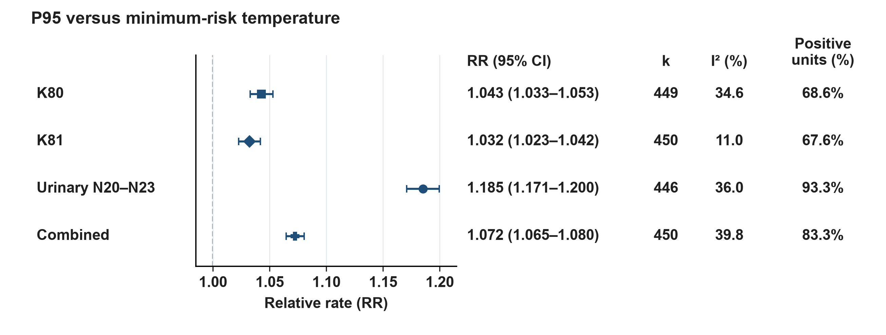

# Supplementary methods

This supplement describes data sources, exposure definitions, statistical models and sensitivity analyses.

## Source records, dates and geographic assignment

Brazilian source records use principal diagnosis DIAG_PRINC, admission date DT_INTER and residential municipality MUNIC_RES. The historical extraction routine retained admission dates from the target year while reading its processing files and applicable later files. Municipalities were mapped through the supplied health-region crosswalk. The primary panel retained its existing region-day health data; missing mapped health observations were left missing rather than filled as zero. Daily exposure was attached by residential health region and admission date. 

The Brazilian clinical cohort used processing-source years 2014–2021 and admission dates 2014–2020. The additional source year contributed records with earlier admission dates. A comparison restricted processing-source years to 2014–2020 while holding admission dates fixed. Authorization identifiers and full-row signatures were checked for repeats. These checks do not establish unique patients or clinical episodes. Missing authorization-type information prevents definitive separation of initial, continuation and resubmitted billing.

Mexico uses principal diagnosis AFECPRIN, admission date INGRE and habitual-residence state ENTIDAD. Hospital CLUES was not the exposure geography. One annual source file was used per source year. The primary cohort combines source years through 2023 and admission dates in 2015–2022, including 2019. Later source files may contribute records with earlier admission dates. Each distinct annual source was included once before aggregation by state and admission date. Annual record IDs reset, and no cross-year patient linkage was assumed.

Published rows were not collapsed into patients or episodes across files. Records with invalid admission dates or residence-state codes were excluded. Source-record checks and exclusions are reported in Table S1. The comparison cohort excluding 2019 is distinguished from the primary cohort.

These are administrative-system records. Brazilian SIH-SUS coverage and the Mexican included DGIS/SAEH facilities do not establish a census of every national admission. A complete source-file calendar is also different from complete individual ascertainment. The original aggregate panels cannot adjudicate repeated admissions, transfers or cross-source episode duplication.

## Weather aggregation and calendar eligibility

Brazil uses population-weighted ERA5-Land temperature. Mexico retains the archived state polygons and coordinate grid, with cosine-latitude area weights over contained valid-land grid cells. These country weights are different. Both use a numerator and valid-weight denominator, so missing land cells do not implicitly become low temperatures. Daily means use the UTC calendar day. Three-day exposure is constructed on actual consecutive dates before outcome or period exclusions.

The Mexican weather extension was retrieved from ERA5-Land using the same grid and aggregation method. Historical file headers were consistent with ERA5-Land, but the original retrieval requests were unavailable. This limits exposure provenance.

The primary cohorts use their full primary-eligible unit-specific P95 and median. Fixed-target independent period refits preserve these numerical targets and the fitted temperature basis. Clinical subcohorts and admission-origin windows build their own shared percentiles and basis from their eligible calendars. Thus, a clinical-cohort percentile contrast is not automatically a fixed-temperature refit of the full primary cohort.

## Adult common-case-mix construct

The adult comparison is broad N20–N23 versus K80. It does not standardize the strict N20 urgency interaction. Each unit first yields age-sex-stratum RRs for P95 versus its shared clinical-cohort median. The same fixed country-level observed combined K80-plus-N20–N23 case weights are applied to both diagnoses:

`RRR_std = (Σ_s w_s RR_urinary,s) / (Σ_s w_s RR_K80,s)`.

The numerator and denominator are arithmetic weighted RRs. The construct does not average baseline admission-count predictions, does not geometrically average stratum RRRs, and does not estimate population-standardized incidence. The nonlinear delta-method gradient is evaluated against the full date-aligned covariance of the twelve stratum log contrasts. Uniform case weights are separately reported. Observed weights are treated as fixed, and cell-count exclusions and numerical failures are retained in the coverage tables. 
## Source-record validation and discharge follow-up

One audited source file per Mexican source year was independently read by principal diagnosis, residence state and admission date. A header-projection reader retained selected columns and treated trailing unselected fields explicitly. Source 2016 dates used month/day/year; the other source formats used their recorded date conventions. Exact state-day agreement with the primary diagnosis counts was verified. 

Annual SAEH files are primarily discharge-based, but source-year/discharge-year concordance is not assumed. Primary-cohort counts retain their original declared source cutoff. The 2023 independent-period extension additionally admits records from the official 2024 SSA discharge source whose admission dates were in 2023. Earlier admission dates in later files are cross-year stays, not automatically late billing. Sectorial files were not mixed with the SSA series. Exact full-row signatures, record IDs within each file, non-ID candidate signatures, dates, geography and discharge-year partitions were audited separately. A candidate non-ID match can represent different people with identical attributes; removing candidate extras is a conservative stress test rather than a validated deduplication rule. The source-exclusivity check retains only source-year/discharge-year-concordant records. Both sensitivities retain all attempted state fits and their eligibility failures.

Brazilian processing-file late billing remains distinct from Mexican cross-year discharge follow-up. The available Brazilian clinical export supports authorization and full-row audits but lacks the authorization-type fields needed to adjudicate every continuation or resubmission. Audited record counts therefore do not establish unique clinical episodes. Table S1 provides numerical diagnostics and follow-up results.

## Aligned marginal contrasts and synchronized uncertainty

The successful primary joint-fit unit sets were fixed before extracting the diagnosis-specific contrasts. Each marginal uses the same fitted exposure basis, full-period numerical P95 and shared median as its unit's direct urinary/K80 contrast. Full joint covariance supplies the direct log-RRR. The two pooled marginal RRs have endpoint-specific weights; their quotient is not the directly pooled RRR.

For a unit contrast with gradient g, the daily influence is formed from the GLM bread, stacked outcome scores aggregated by actual date and g. Country influences sum the normalized DL-weighted unit influences on the same calendar. Bartlett covariance is evaluated at the stated 14-, 28- or 90-day bandwidth. Principal interval variance is V_sync + tau_DL^2 × sum(w_normalized^2), conditional on observed weights and heterogeneity. The DL point estimate is unchanged. This additional modeled component does not estimate uncertainty in weights/tau and is not a spatial bootstrap. The synchronized covariance and its component terms, independent-unit DL/REML–HK comparisons, sample identities and PSD diagnostics accompany Table S4.

## Alternative calendar specifications

The final complete-source Mexican primary cohort received a diagnosis-specific year-month fixed-effect check. The flexible-calendar model retained the fixed exposure basis and targets and used diagnosis-specific weekday, national holiday and a continuous natural time spline with six degrees of freedom per analysis year. It replaced fixed month categories and the low-frequency full-period 12-df trend. Calendar definitions, package/version, actual degrees of freedom and fit attempts are archived with the temporal module. A quasi-Poisson GLM with year-month factors is not described as conditional Poisson likelihood. The primary Brazilian comparison and the strict-code four-outcome urgency model received the same flexible-calendar check. The urgency model excluding 2020 retained the full clinical-period targets and basis; it did not redefine percentile temperatures after exclusion. Both baseline and amended estimates are repooled on the successful comparison set when membership differs. Table S11 includes all unit attempts and scientific failures. 

The exclusion-of-2020 urgency sensitivity is separate from the full-period flexible-calendar sensitivity. It retains the original diagnosis-specific weekday, month and ns(time,12) adjustment; it does not combine exclusion with the six-df-per-year holiday model.

## Adult bridge and strict phenotype replication

Adult unstandardized and common-case-weight summaries use the same successful geographic set, eligible calendar, broad urinary/K80 definition and temperature targets. A discrepancy between whole-country and standardized-subset estimates is therefore not attributed solely to standardization. When new adult fits fail, both sides are repooled on the explicit common-success set. Brazilian matched-source adult reference weights were originally reused in the preferred later-processing-source cohort; preferred-cohort observed weights are reported as a sensitivity. Weights remain descriptive case weights rather than population weights. The bridge does not age-sex adjust the distinct strict-N20 urgency interaction.

Mexican N20/K80, N20–N21/K80 and N23/K80 secondary fits are separately identified. Their reconstructed dates, targets, event totals, coefficients and HAC covariance were checked against saved outputs. Sparse N23 fits and all attempted states remain visible. These are principal administrative diagnosis phenotypes, without imaging adjudication, stone composition or onset dates. Table S7 preserves the bridge coverage and phenotype attempts.

## Distributed-lag specification

The distributed-lag check models raw daily mean temperature, not a rolling E3 input. A natural temperature spline with three degrees of freedom is crossed with a three-df lag spline over lags 0–21, yielding nine cross-basis columns. The lag spline has an internal knot at sqrt(21) and boundary knots at 0 and 21. For each unit, the temperature basis was trained on finite raw daily mean temperatures from the common primary-analysis paired E3-eligible dates. It used a natural spline without an intercept, with internal knots at the one-third and two-thirds sample quantiles and boundary knots at the minimum and maximum of those daily temperatures. Prediction reused this fitted basis. The quasi-Poisson formula includes diagnosis interactions with the cross-basis, weekday, month and ns(time,12), plus a log-population offset only in Brazil. At least 400 complete-history paired dates and 40 events per endpoint are required. Missing exposure history is not bridged over missing dates. Daily stacked scores use calendar-aligned Bartlett HAC28 with no additional quasi-dispersion multiplier. Full coefficient covariance yields the cumulative contrast, and country pooling uses the stated DL and REML–HK alternatives. The sustained temperature history is set to the numerical main-analysis E3 P95 versus median across the lag span. It therefore tests a different exposure history from the primary three-day-mean contrast. Lag-specific results retain their lag indices.

## Curve covariance, support and weighting

The three curves project the same joint coefficient vector and covariance onto the local-median contrast at each displayed temperature. A unit contributes only within its observed E3 P2–P98 with at least 30 eligible days within ±1 degree. DL and profiled REML–Hartung–Knapp are evaluated on identical contributor sets. Covariance PSD, direct-cross-covariance reconstruction, maximum normalized weights, effective unit count and variance ratios are audited. Effective unit count is 1/sum(w_normalized^2); it is a weight diagnostic, not a sample size of patients. Very large sampling-variance ratios generated recorded metafor stability warnings. No arbitrary variance floor or convenient-unit exclusion was imposed. A curve crossing can change with the pooling method and does not identify a biological threshold. Display is limited to 30 degrees. Table S17 gives the identical-support example and full diagnostics.

## Temperature target summaries

Table 1 and Table S2 summarize each unit's primary median, P95 and their difference with equal weight per geographic unit. Descriptive quantiles use R type 7; these are distinct from weighted empirical-CDF summaries and percentiles of the pooled unit-day distribution. Type-7 quantiles linearly interpolate adjacent ordered values at index h = 1 + (n − 1)p, where n is the number of observations and p is the requested probability. They describe the actual unit-specific contrasts rather than a common absolute temperature intervention.

## Interpretation of secondary analyses

The primary comparison in this report is the shared-median urinary N20–N23-versus-K80 contrast, interpreted alongside the aligned diagnosis-specific marginal associations. The eight-cell grid and the calendar, phenotype, case-mix, moisture, period-refit and support checks are sensitivity or secondary analyses, not separate confirmatory endpoints. Some cohort definitions and secondary analyses were developed after earlier results were known. The study was not prospectively registered, and secondary analyses did not use comprehensive multiplicity control. All alternative estimates, intervals spanning one, fit failures and source restrictions are reported. The study estimates temperature–admission associations and an association-based count scenario; it does not estimate anthropogenic climate attribution.

## Additional outcome and model definitions

K85 was excluded because annual admission counts during 2008–2012 showed a recording discontinuity: 11,318, 237, 243, 4,177 and 11,718. K81 was a third modeled outcome in the primary stacked model. Common-date eligibility and the minimum of 40 events applied to K80, K81 and urinary N20–N23 separately, while the primary reported contrast compared urinary diagnoses with K80.

In the Brazilian grid, the shared-calendar model retained diagnosis-specific exposure coefficients and shared the weekday, month and ns(time,12) coefficients across diagnoses. The primary model instead interacted all these calendar terms with diagnosis. Emax3 was the three-day moving mean of daily maximum temperature. In the grid, full denotes the 2006–2020 analysis period rather than the primary calendar specification.

Mexican TIPSERV 2 denoted short stay and was not used as an emergency indicator. Urgent and elective Brazilian categories were CAR_INT 02 and 01; Mexican PROCED 2 and 1 described emergency-department and outpatient-consultation origin.

For the adult case-weight construct, let θ_o,s = log(RR_o,s). The gradient of log(RRR_std) is w_s RR_urinary,s / Σ_s w_s RR_urinary,s for urinary terms and −w_s RR_K80,s / Σ_s w_s RR_K80,s for K80 terms. Delta-method variance uses this gradient and the full date-aligned covariance of the twelve log contrasts. Weights are treated as fixed. The same successful units, dates and targets are used for the matched unstandardized and standardized comparisons.

## Figure S1. Exploratory P95-versus-MRT associations

Exploratory Brazilian diagnosis-specific rate ratios (RRs) compare the local 95th percentile (P95) of three-day mean temperature with the fitted minimum-risk temperature (MRT), constrained to the local P10–P60 range (tenth to sixtieth percentiles). K80 combines gallbladder and bile duct stones; K81 identifies cholecystitis; urinary N20–N23 includes urinary calculi and unspecified renal colic. Combined is the sum of these three diagnosis groups. Points are DerSimonian–Laird estimates; bars show 95% confidence intervals conditional on the selected minimum. The vertical line marks RR=1. The geographic-unit counts (k), between-unit heterogeneity (I²) and percentages of units with RR>1 are: K80, k=449, 34.6%, 68.6%; K81, k=450, 11.0%, 67.6%; urinary N20–N23, k=446, 36.0%, 93.3%; combined sum3, k=450, 39.8%, 83.3%. These estimates use a diagnosis-specific optimized reference; the primary comparison uses a shared median. The percentages describe the selected-MRT estimates, rather than an independent comparison at fixed reference temperatures. MRT selection summaries are in Table S15.
